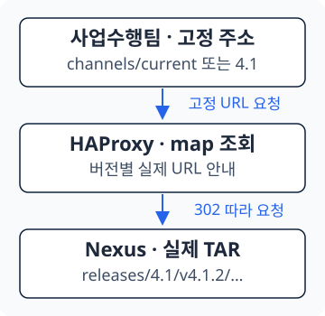

<section class="editorial-summary editorial-summary--text-only" aria-labelledby="editorial-summary-title">
  <div class="editorial-summary-layout">
    <div class="editorial-summary-copy">
      <span class="editorial-summary-label">사내 Gitea 경량화 · 자동 패키징 편</span>
      <h2 id="editorial-summary-title" class="editorial-summary-title">팀은 릴리스를 확정하고, Runner는 반입용 TAR를 만든다.</h2>
      <p>코드와 설치 재료를 분리한 뒤에도 사람이 파일을 하나씩 모으면 누락과 버전 혼동은 남는다. 릴리스 태그와 manifest를 기준으로 Runner가 재료를 수집하고, 사업수행팀은 Nexus의 고정 주소에서 패키지 하나를 받도록 구성했다.</p>
    </div>
  </div>
  <p class="editorial-summary-result"><span>결과물은 <strong>contrabass-engine-deploy.tar</strong>. 코드·이미지·일반 파일·고객사용 Nexus와 실행 스크립트를 함께 담는다.</span></p>
</section>

[3편](../design/2026-10-15-gitea-lightweight-3.md)에서는 Git의 대용량 파일을 Nexus로 옮기고 Ansible의 다운로드 경로를 바꿨다. 이제 코드만 clone할 수 있지만, 폐쇄망에 가져갈 때는 코드와 설치 재료를 다시 한곳에 모아야 한다.

이 수집 작업을 Gitea Actions와 Runner에 맡겼다. 이번 편은 **자동 패키징 구조 → Workflow 흐름 → 팀의 릴리스 작업 → 사업수행팀 다운로드** 순서로 설명한다. VM을 만들어 배포 시험하는 OpenTofu 연계는 마지막에 별도 가이드로 연결한다.

## 1. 자동 패키징 구조

**Workflow**는 언제 어떤 명령을 실행할지 적은 작업 정의이고, **Runner**는 그 명령을 실제로 실행하는 프로그램이다. Gitea가 작업을 관리하고 Runner가 실행 로그와 결과를 돌려준다. [Gitea Actions](https://docs.gitea.com/1.25/usage/actions/overview/), [Runner 실행 구조](https://docs.gitea.com/runner/)

<figure class="flow" aria-label="릴리스 패키징 전체 흐름">
  <ol>
    <li>릴리스 태그 push</li>
    <li>Runner에서 재료 수집·TAR 생성</li>
    <li>Nexus 게시·채널 갱신</li>
    <li>사업수행팀 다운로드</li>
  </ol>
</figure>

Runner는 [2편](../design/2026-10-15-gitea-lightweight-2.md)의 **호스트 실행 방식, 동시 작업 1개**를 사용한다. 호스트의 nerdctl·containerd와 파일 캐시를 이용하고, 코드에서 사용할 이미지를 새로 빌드하는 대신 이미 준비된 이미지를 모아 내보낸다.

Nexus의 역할도 재료와 결과물로 구분된다.

| Repository | 보관하는 것 | 주로 사용하는 쪽 |
| --- | --- | --- |
| `docker-hosted` | Ansible·Ceph 등 컨테이너 이미지 | Runner·배포 노드 |
| `raw-hosted` | 바이너리·프로그램 압축 파일·VM 이미지 | Runner·Ansible 대상 노드 |
| `raw-manifest` | 릴리스별 재료 목록과 식별 정보, 채널 메타데이터 | 패키징 스크립트·운영자 |
| `raw-release-bundle` | 완성된 `contrabass-engine-deploy.tar` | 사업수행팀 |

`manifest.yaml`은 **이번 릴리스에 넣을 재료 목록**이다. 경로·이미지 태그뿐 아니라 파일 SHA256과 이미지 digest도 기록한다. Nexus에 마지막으로 업로드된 파일을 임의로 고르는 방식이 아니다.

패키지는 다음처럼 구성된다. 컨테이너 이미지 묶음뿐 아니라, 고객사에서 Nexus를 처음 띄우는 데 필요한 재료도 포함한다.

```text title="최종 TAR 안의 주요 파일"
contrabass-engine-deploy/
├── deploy.sh                          # 고객사 실행 진입점
├── setup-private-environment.sh       # 런타임·Private Nexus 준비와 재료 반입
├── manifest.yaml                      # 설치 재료 목록
├── release-info.yaml                  # 릴리스·Git·manifest 식별 정보
├── SHA256SUMS                         # 내부 파일의 체크섬 목록
├── git/init-container/                # 해당 태그의 코드
├── raw/                               # manifest에 명시한 일반 파일
├── images/
│   ├── release-images.tar             # 여러 컨테이너 이미지를 함께 저장
│   └── image-map.txt                  # 이미지 이름·태그·digest 대응표
└── nexus/
    ├── nexus-image.tar                # Nexus 자체의 컨테이너 이미지
    ├── compose.yaml
    └── nexus.properties
```

사내 Nexus의 DB나 Blob Store 전체를 복제하는 패키지는 아니다. 고객사에서는 빈 Nexus를 띄운 뒤 **이번 manifest에 지정한 파일과 이미지**를 반입한다.

---

## 2. Workflow 흐름

Workflow 파일은 `.gitea/workflows/publish-manifest.yaml` 하나를 진입점으로 사용한다. 이름에 manifest가 있지만, manifest 게시부터 최종 패키지 게시까지 이어지는 작업을 호출한다.

<p class="subsection-title"><strong>2-1. 일반 push가 아니라 릴리스 때 실행</strong></p>

<div class="section-body" markdown="1">

아래는 실행 조건을 보여주는 발췌다. 전체 Workflow에서 Steps를 뺀 부분이며, 이 코드만으로 패키징이 동작하는 것은 아니다.

```yaml title="publish-manifest.yaml — 실행 조건 발췌"
name: Publish private cloud release

"on":
  push:
    tags:
      - "v*"
  workflow_dispatch:
    inputs:
      release_tag:
        description: Existing release tag
        required: true

jobs:
  release:
    runs-on: linux_amd64
```

`runs-on`은 등록한 Runner의 라벨과 맞춘다. 여기서는 2편의 `linux_amd64:host` 라벨을 기준으로 했다.

| 작업 | 최종 패키징 |
| --- | --- |
| 개발 중 코드·manifest를 브랜치에 push | 이 Workflow는 실행하지 않음 |
| `v4.1.2` 같은 릴리스 태그 push | 태그의 코드와 manifest로 실행 |
| Actions 화면에서 기존 태그를 지정해 수동 실행 | 해당 릴리스를 다시 처리 |

태그는 스크립트에서 `vX.Y.Z` 형식인지 확인하고, manifest의 `release` 값과 비교한다. **태그 조건과 master 브랜치 보호는 별개**다. 이 실행 조건만으로 태그의 커밋이 master에 포함되는지까지 검사하지는 않는다.

</div>

<p class="subsection-title"><strong>2-2. 어떤 스크립트가 무엇을 만드는가</strong></p>

<div class="section-body" markdown="1">

코드는 선택한 태그를 `--depth=1 --single-branch`로 한 번 clone한다. 빌더가 Git을 다시 받는 대신, Workflow가 받은 소스를 최종 TAR에 넣는다.

| 순서 | 실행 파일 | 입력 → 결과 |
| --- | --- | --- |
| ① manifest 게시 | `/opt/gitea/bundle-builder/publish-manifest.sh` | 코드의 manifest·태그·커밋 → Nexus의 manifest, 작업공간의 `release-info.yaml` |
| ② 빌드 진입점 | `/usr/local/sbin/build-private-release` | 태그·clone 경로 → 설치된 빌더 실행 |
| ③ TAR 제작 | `/opt/gitea/bundle-builder/build-bundle.sh` | 소스·manifest·Nexus 재료 → 로컬 TAR와 체크섬 |
| ④ 최종 게시 | `/opt/gitea/bundle-builder/publish-bundle.sh` | `release-info.yaml`·TAR → 버전별 Nexus 파일, 보관 목록·채널 갱신 |
| ⑤ 다운로드 주소 갱신 | `/usr/local/sbin/update-release-alias` | 갱신할 채널·태그 → HAProxy map 갱신 |

`build-private-release`와 `build-bundle.sh`는 중복 빌더가 아니다. 앞의 파일은 실행 권한과 호출을 제한하는 진입점이고, 뒤의 파일이 실제 제작 작업을 한다. `common.sh`는 공통 설정과 보조 함수를 읽는 데 사용한다.

**`manifest_id`는 이 단계들을 연결하는 식별자**다. 릴리스 번호·커밋 시각·짧은 커밋 해시를 조합해 만들고, `release-info.yaml`에 담아 다음 단계로 전달한다.

```text title="같은 릴리스를 연결하는 값"
태그:          v4.1.2
manifest:      release: "4.1.2"
manifest_id:   manifest-v4.1.2-<커밋시각>-<커밋해시>
로컬 TAR:      <manifest_id>.tar
Nexus TAR:     releases/4.1/v4.1.2/contrabass-engine-deploy.tar
```

같은 이름의 `release-info.yaml`도 용도를 구분한다. **manifest 저장소의 파일**은 Git 커밋과 manifest 경로·해시를 기록한다. **Bundle 저장소의 파일**은 TAR 경로·해시·크기를 기록한다. 사업수행팀이 두 파일을 조합해서 패키지를 만드는 구조는 아니다.

</div>

<p class="subsection-title"><strong>2-3. 재료는 재사용하고, 새 릴리스는 다시 묶는다</strong></p>

<div class="section-body" markdown="1">

코드 한 줄만 바뀌었는데 이미지 전체를 다시 다운로드하면 경량화 효과를 체감하기 어렵다. 재료를 가져오는 작업과 최종 TAR 생성은 분리했다.

| 대상 | 재사용 기준 | 새 릴리스에서 수행하는 일 |
| --- | --- | --- |
| Raw 파일 | SHA256이 같은 캐시 파일 | 캐시를 확인하고 없거나 손상된 파일만 다운로드 |
| 컨테이너 이미지 | containerd에 있는 콘텐츠 | Registry digest 확인·pull 수행, 이미 있는 레이어 재사용 |
| 최종 TAR | 같은 릴리스의 완성된 산출물 | 새 태그라면 코드·재료를 다시 묶어 별도 TAR 생성 |

따라서 **pull 명령이 다시 실행되는 것과 이미지 본문을 전부 다시 받는 것은 다르다.** Registry 조회는 남을 수 있지만, 같은 콘텐츠의 레이어는 런타임 캐시를 이용한다. 반면 `nerdctl save`와 최종 TAR 생성·업로드는 새 릴리스에서 다시 필요하다. [containerd 콘텐츠 저장 구조](https://github.com/containerd/containerd/blob/main/docs/content-flow.md)

<details class="analysis-toggle" markdown="1">
<summary>Runner의 설정·작업 경로·캐시는 어디에 두는가?</summary>

주소와 경로는 `/etc/gitea-runner-env/bundle-pipeline.env`에 모은다. 아래는 관련 항목의 예시다. 전체 서비스 설치 설정은 [2편](../design/2026-10-15-gitea-lightweight-2.md)에서 다룬다.

```bash title="bundle-pipeline.env — 관련 항목"
NEXUS_URL=https://192.0.2.10:55555
PUBLIC_RELEASE_URL=https://192.0.2.10:8443
GITEA_REPO_URL=https://gitea.example.com/team/private-cloud-v4.git

MANIFEST_REPOSITORY=raw-manifest
BUNDLE_REPOSITORY=raw-release-bundle
RAW_REPOSITORY=raw-hosted
DOCKER_REPOSITORY=docker-hosted

BUNDLE_BUILDER_DIR=/opt/gitea/bundle-builder
BUNDLE_WORK_DIR=/data/private-release
RAW_CACHE_DIR=/data/private-release-cache/raw/sha256
RUNNER_WORKSPACE=/var/lib/gitea-runner/workspace
RELEASE_KEEP_COUNT=2
```

`RUNNER_WORKSPACE`는 Workflow의 clone·작업 경로다. `BUNDLE_WORK_DIR`는 TAR를 만들고 게시하기 전까지 두는 공간이며 장기 보관소가 아니다. 게시 검증 후 로컬 TAR와 체크섬은 지우고, Raw 캐시와 containerd 이미지 콘텐츠는 다음 작업을 위해 남긴다.

비밀번호·Git 읽기 토큰은 이 공개 설정 예시에 넣지 않는다. Gitea Actions Secrets에서 Workflow로 전달하며, Runner 등록 토큰과 저장소 읽기 토큰은 용도가 다르다.

</details>

<details class="analysis-toggle" markdown="1">
<summary>같은 태그로 재실행하면 무조건 다시 만드는가?</summary>

항상 새로 만드는 것은 아니다.

- 같은 경로의 manifest가 있고 해시가 같으면 재사용한다. 내용이 다르면 중단한다.
- 완성된 로컬 TAR와 체크섬이 맞으면 재사용할 수 있다.
- Nexus에 TAR와 체크섬이 모두 게시되어 있으면 빌드를 건너뛰고 게시 마무리를 진행할 수 있다.
- TAR만 있거나 체크섬만 있는 불완전한 상태는 정상 완료로 취급하지 않는다.

재실행 기능이 있다고 모든 실패를 자동 복구하는 것은 아니다. Actions 로그에서 실패 지점과 산출물 상태를 확인하고, 이미 발행한 태그의 내용을 바꾸기보다 필요한 수정은 새 버전으로 낸다.

</details>

</div>

---

## 3. 팀의 릴리스 작업

개발자가 매번 TAR를 만드는 대신, **어떤 코드를 릴리스할지 확정하는 작업**을 맡는다.

1. 파일·이미지가 바뀌었다면 Nexus에 새 버전으로 업로드한다.
2. `release/manifest.yaml`의 경로·해시·이미지 태그·digest를 맞춘다.
3. Ansible의 `nexus.yml`도 같은 파일·이미지를 가리키게 수정한다.
4. 코드와 manifest를 반영하고 릴리스할 커밋을 확정한다.
5. 그 커밋에 새 태그를 만들고 해당 태그만 push한다.

코드만 바뀌고 설치 재료가 같아도 새 릴리스 태그를 붙인다. 이미지·manifest만 바뀌는 경우도 마찬가지다. **브랜치의 계속 바뀌는 최신 상태가 아니라 태그의 코드와 재료 목록을 함께 배포**한다.

다음은 `master`의 확인한 커밋을 `v4.1.2`로 내는 예다. manifest의 `release`도 `4.1.2`여야 한다. 태그 push는 패키징을 실행시키는 작업이다.

```bash title="릴리스 담당자의 작업 예시"
git switch master
git pull --ff-only origin master
git status --short
git log -1 --oneline

# 작업 트리가 깨끗하고 릴리스할 커밋이 맞는지 확인한 뒤 실행
git tag -a v4.1.2 -m "Release 4.1.2" HEAD
git push origin v4.1.2
```

`git tag`는 로컬에 이름표를 만들고, `git push origin v4.1.2`가 그 태그를 서버로 보낸다. 태그 생성 자체가 코드를 다른 브랜치로 merge하는 것은 아니다. [Git 태그](https://git-scm.com/docs/git-tag)

이후 Gitea의 **저장소 → Actions → 해당 실행**에서 clone·manifest·빌드·게시 로그를 확인한다. 태그 이름, manifest 버전, 수집한 재료, 게시 경로가 맞는지 확인하고 사업수행팀에 릴리스를 안내한다.

!!! note "배포 시험을 붙인 경우의 게시 시점"
    패키징과 배포 검증은 다른 단계다. OpenTofu 검증을 연계한 Workflow는 **TAR 생성 → staging 게시 → VM 설치·기능 시험 → 통과한 동일 TAR 최종 게시** 순서로 실행한다. 이때 `publish-bundle.sh`와 채널 갱신은 시험 뒤에 둔다. 상세 구성은 [OpenTofu 입문가이드 5](../concepts/2026-10-15-opentofu-staging-release.md), [6](../concepts/2026-10-15-opentofu-functional-test-cleanup.md)에서 이어진다.

---

## 4. 사업수행팀 다운로드

사업수행팀은 Git과 Nexus의 재료를 각각 수집하지 않는다. **원하는 채널에서 TAR 하나를 받는다.** 채널은 배포 대상으로 안내할 버전을 가리키는 고정 주소다.

| 필요한 패키지 | 고정 주소 |
| --- | --- |
| 전체 최신 릴리스 | `/repository/raw-manifest/channels/current/contrabass-engine-deploy.tar` |
| 4.1 계열 최신 패치 | `/repository/raw-manifest/channels/4.1/contrabass-engine-deploy.tar` |
| 보관 중인 특정 버전 | `/repository/raw-release-bundle/releases/4.1/v4.1.2/contrabass-engine-deploy.tar` |

고정 주소에 대용량 TAR를 하나 더 저장하는 것은 아니다. **실제 TAR는 버전 경로에만 두고 HAProxy가 302 리다이렉트로 연결**한다. 302는 클라이언트에게 실제 다운로드 주소로 다시 요청하도록 알리는 HTTP 응답이다.

[{ .architecture-diagram }](../assets/gitea-lightweight-4/channel-download.svg)

예를 들어 `v4.1.3`을 발행하면 4.1 채널은 그 버전을 가리킨다. 전체 최신이 이미 4.2 계열이라면 `current`는 4.2를 유지한다. **마지막에 빌드한 태그를 무조건 전체 최신으로 지정하지 않는다.**

| 게시한 릴리스 | 갱신하는 주소 |
| --- | --- |
| 해당 계열에서 가장 높은 버전 | `channels/<계열>/` |
| 전체에서 가장 높은 버전 | 위 주소와 `channels/current/` |
| 이미 더 높은 버전이 있는 과거 릴리스 | 그 버전이 최신이 아닌 채널은 유지 |

`update-release-alias`가 map 파일과 HAProxy의 실행 중 map을 갱신한다. 새 릴리스마다 HAProxy 설정 본문을 사람이 수정하는 구조는 아니다. 채널 메타데이터는 Nexus에 실제 파일로 저장하지만, 채널의 TAR 주소는 이 리다이렉트로 제공한다. [HAProxy map 갱신](https://www.haproxy.com/documentation/haproxy-runtime-api/reference/set-map/)

<p class="subsection-title"><strong>4-1. 원하는 계열을 선택해 다운로드</strong></p>

<div class="section-body" markdown="1">

인터넷·사내망에 접근 가능한 작업 서버의 다운로드 디렉터리에서 실행한다. `download-user`는 읽기 계정의 예시이며 비밀번호는 프롬프트에 입력한다. 전체 최신은 `current`, 특정 계열은 `4.1`처럼 지정한다.

```bash title="전체 최신 패키지 받기"
CHANNEL=current

curl -kfL --user download-user \
  "https://192.0.2.10:8443/repository/raw-manifest/channels/${CHANNEL}/contrabass-engine-deploy.tar" \
  -o contrabass-engine-deploy.tar
```

`-L`이 있어야 302가 안내하는 실제 TAR까지 받는다. 별도의 manifest를 먼저 내려받아 경로를 계산하지 않아도 된다. **HTTP 요청은 리다이렉트를 따라가지만, 대용량 TAR 본문을 두 번 다운로드하는 것은 아니다.**

</div>

<p class="subsection-title"><strong>4-2. 고객사에 반입한 뒤 실행</strong></p>

<div class="section-body" markdown="1">

다운로드한 TAR를 고객사의 전용 배포 노드로 옮긴 뒤 압축을 푼다. 기존 실행 환경에 덮어쓰지 않도록 별도의 작업 디렉터리에서 진행한다.

```bash title="고객사 배포 노드에서 실행"
tar -xf contrabass-engine-deploy.tar
cd contrabass-engine-deploy
sudo ./deploy.sh 192.0.2.101 --accept-eula
```

`192.0.2.101`은 고객사에서 Private Nexus를 띄울 배포 노드 주소로 바꾼다. `--accept-eula`는 Nexus 사용약관을 확인한 뒤 동의를 표시하는 인자다.

스크립트는 런타임과 Private Nexus를 준비하고, 가져온 파일·이미지를 넣은 뒤 Ansible 컨테이너를 실행한다. **이 단계와 OpenStack 전체 배포 완료는 구분**한다. 이후 inventory·배포 변수를 맞추고 Ansible을 수행하는 과정은 [3편](../design/2026-10-15-gitea-lightweight-3.md)의 흐름으로 이어진다.

</div>

완성된 Bundle은 **계열별 최신 두 버전**을 보관한다. 예를 들어 4.1.1·4.1.2가 있는 상태에서 4.1.3을 게시하면 4.1.2·4.1.3을 남긴다. 이는 Bundle 보관 정책이지 Git 태그나 원본 Raw·이미지를 함께 삭제하는 정책은 아니다.

Git이 설치 재료 전체를 보관하던 역할은 끝나고, **릴리스할 코드와 재료 목록을 확정하는 역할**이 남는다. Runner는 그 기준으로 반입 파일을 만들고, 사업수행팀은 고정된 다운로드 방식으로 같은 결과물을 가져간다.
