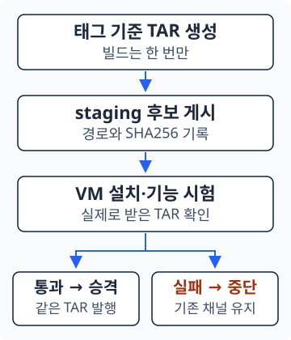

<section class="editorial-summary editorial-summary--text-only" aria-labelledby="editorial-summary-title">
  <div class="editorial-summary-layout">
    <div class="editorial-summary-copy">
      <span class="editorial-summary-label">사내 Gitea 경량화 · 릴리스 검증 편</span>
      <h2 id="editorial-summary-title" class="editorial-summary-title">TAR를 만들었다고 릴리스하지 않는다. 설치해 본 같은 TAR만 발행한다.</h2>
      <p>패키징 성공만으로 고객사에서 설치할 수 있다고 판단하기는 어렵다. 결과물을 staging에 먼저 두고, VMware 시험 VM에서 Private Nexus·Ansible·OpenStack 배포를 확인한 뒤 정식 다운로드 대상으로 승격한다.</p>
    </div>
  </div>
  <p class="editorial-summary-result"><span><strong>한 번 빌드 → 후보 게시 → 배포·기능 시험 → 동일 TAR 발행</strong>. 시험에 실패하면 기존 다운로드 채널을 유지한다.</span></p>
</section>

[4편](2026-10-21-gitea-lightweight-4.md)에서는 태그의 코드와 manifest를 모아 반입용 TAR를 만들었다. 이번에는 그 TAR를 사업수행팀에 공개하기 **전**에 배포 시험을 넣는다. 사업수행팀이 검증된 파일을 사용하는 과정은 [6편](../design/2026-10-21-gitea-lightweight-6.md)으로 이어진다.

## 1. 생성과 발행 사이에 staging을 둔다

**staging**은 아직 시험을 마치지 않은 릴리스 후보를 보관하는 영역이다. **승격**은 시험을 통과한 후보를 정식 배포 대상으로 발행하는 과정이다.

```text title="기존 패키징과 검증을 연결한 패키징"
패키징 기본 흐름:  빌드 → 최종 게시 → current 갱신
검증 연계 흐름:    빌드 → staging → 배포 시험 → 최종 게시 → current 갱신
```

[{ .architecture-diagram }](../assets/gitea-lightweight-5/promotion-gate.svg)

중요한 것은 시험 뒤에 다시 빌드하지 않는다는 점이다. **시험한 TAR와 사업수행팀이 받을 TAR의 SHA256이 같아야 한다.** 코드·재료가 같아 보이더라도 다시 만든 파일을 시험 결과에 연결하지 않는다.

Nexus에는 `raw-release-staging`이라는 **Raw Hosted Repository**를 하나 추가한다. Nexus의 별도 Staging 제품 기능이 아니라, 일반 파일 저장소와 HTTP 업로드를 사용한다. [Nexus Raw Repository](https://help.sonatype.com/en/raw-repositories.html)

| 구분 | 후보 저장소 | 최종 저장소 |
| --- | --- | --- |
| Repository | `raw-release-staging` | `raw-release-bundle` |
| 용도 | 아직 시험 중인 TAR | 시험을 통과해 발행한 TAR |
| 읽는 쪽 | 시험 VM·Runner | 사업수행팀 |
| 채널 연결 | 없음 | `channels/current`, `channels/4.x` |
| 정리 | 이번 후보를 시험 후 삭제 | 계열별 최신 두 버전 보관 |

```text title="후보와 최종 결과물의 경로"
raw-release-staging/
└── candidates/<manifest_id>/<SHA256>/
    ├── contrabass-engine-deploy.tar
    └── contrabass-engine-deploy.tar.sha256

raw-release-bundle/
└── releases/4.1/v4.1.2/
    ├── contrabass-engine-deploy.tar
    ├── contrabass-engine-deploy.tar.sha256
    └── release-info.yaml
```

후보 경로에는 릴리스 식별자와 TAR 해시를 넣는다. 시험 VM은 `current`가 아니라 **이번 Job이 게시한 후보의 정확한 주소**를 받는다. 그래야 시험 도중 다른 릴리스가 올라와도 다른 파일을 설치하지 않는다.

<details class="analysis-toggle" markdown="1">
<summary>Nexus에서 추가로 준비할 설정과 권한</summary>

**설정 → Repositories → Create repository → raw (hosted)**에서 `raw-release-staging`을 만든다. Blob Store는 기존 아티팩트용 저장소를 사용할 수 있다. 같은 후보 경로의 덮어쓰기를 막으려면 Deployment Policy를 `Disable redeploy`로 둔다.

| 계정 | 필요한 작업 |
| --- | --- |
| CI 게시 계정 | staging 조회·읽기·업로드·정리용 삭제. 기존 최종 게시·채널 갱신 권한도 유지 |
| VM 다운로드 계정 | staging 읽기 |
| 사업수행팀 다운로드 계정 | 기존 최종 결과물 읽기. staging 접근은 불필요 |

통합 설정 `/etc/gitea-runner-env/bundle-pipeline.env`에 저장소 이름을 추가한다. `BUNDLE_REPOSITORY`를 staging으로 바꾸지는 않는다.

```bash title="통합 설정에 추가"
STAGING_REPOSITORY=raw-release-staging
```

계정의 비밀번호는 Actions Secrets로 전달한다. staging 게시를 위해 최종 게시 스크립트를 먼저 호출하면 안 된다. 그 스크립트에는 채널 갱신과 오래된 Bundle 삭제도 포함되어 있기 때문이다.

</details>

---

## 2. Runner가 시험 환경을 만들고 설치한다

Workflow는 `.gitea/workflows/publish-manifest.yaml` 하나를 유지한다. 기존 `release` Job 안에서 **최종 게시 호출을 시험 뒤로 옮긴다.** 패키징 Workflow와 시험 Workflow를 서로 독립 실행해 순서를 맞추는 방식이 아니다.

| 순서 | Runner가 하는 일 | 다음 단계에 넘기는 것 |
| --- | --- | --- |
| ① | 태그 shallow clone·manifest 게시·TAR 생성 | `release-info.yaml`, 로컬 TAR |
| ② | TAR와 체크섬을 staging에 업로드 | `staging-info.yaml`의 후보 경로·해시 |
| ③ | OpenTofu로 VMware VM 4대 생성 | VM 주소·SSH로 접근할 시험 환경 |
| ④ | 첫 VM에서 후보 다운로드·배포 실행 | Private Nexus·Ansible·OpenStack 환경 |
| ⑤ | 배포 후 OpenStack 기능 시험 | 통과한 후보의 해시 |
| ⑥ | 동일 TAR 최종 게시·채널 갱신 | 사업수행팀이 받을 정식 결과물 |
| ⑦ | 시험 자원·VM·staging 정리 | Actions 로그·보존할 관리 기록 |

**OpenTofu**는 선언한 구성대로 클라우드 자원을 생성·관리하는 도구다. 여기서는 vCenter를 통해 템플릿을 복제하는 작업과, 새 OpenStack에 시험 자원을 만드는 작업을 각각 맡긴다.

<p class="subsection-title"><strong>2-1. 시험 VM과 Deploy Node</strong></p>

<div class="section-body" markdown="1">

VM은 네 대로 고정하고, 시험 전용 IP와 네트워크를 예약한다. 첫 VM은 Deploy Node이면서 OpenStack 구성 노드이기도 하다. 별도의 다섯 번째 배포 VM을 만드는 구조가 아니다.

| VM | API망 주소 예시 | 역할 |
| --- | --- | --- |
| `runner01` | `192.0.2.101` | Deploy Node + Controller·Compute·Ceph |
| `runner02` | `192.0.2.102` | Controller·Compute·Ceph |
| `runner03` | `192.0.2.103` | Controller·Compute·Ceph |
| `runner04` | `192.0.2.104` | Compute·Ceph OSD |

VM 생성 뒤에는 모든 VM의 SSH 접속 준비를 확인한다. 첫 VM이 staging의 TAR를 직접 내려받고 해시를 확인한 뒤 `deploy.sh`를 실행한다. 그다음 컨테이너가 보는 inventory와 배포 변수에 따라 Ansible을 수행한다. 시험용 설정이 이미 코드에 준비되어 있다면 별도의 설정 복사 과정은 필요 없다.

VMware 템플릿·NIC·공개키 구성과 Runner 연결은 기존 [OpenTofu 입문가이드 2](../design/2026-10-08-opentofu-vsphere-rocky.md), [4](../concepts/2026-10-14-opentofu-gitea-runner.md)를 참고한다. 이 편에서는 릴리스 판정을 연결하는 지점에 집중한다.

</div>

<p class="subsection-title"><strong>2-2. 사전 점검과 배포 후 기능 시험은 다르다</strong></p>

<div class="section-body" markdown="1">

| 시점 | 확인할 것 | 알 수 있는 것 |
| --- | --- | --- |
| 배포 전 | VM SSH, Nexus·Ansible 컨테이너 실행 | 배포를 시작할 준비가 됨 |
| 배포 중 | `ansible-playbook` 정상 종료 | 선언한 배포 작업이 완료됨 |
| 배포 후 | OpenStack API로 시험 자원 생성·결과 확인 | 기본 기능이 실제로 동작함 |

컨테이너가 실행된다는 사실만으로 OpenStack 기능 시험까지 통과한 것은 아니다. 반대로 배포 전에 SSH와 컨테이너를 확인하는 작업은 필요한 사전 점검이다.

기능 시험은 별도 `openstack-smoke` 프로젝트에서 수행한다. **Smoke test**는 모든 기능을 검증하는 시험이 아니라, 핵심 동작을 빠르게 확인하는 기본 시험이다.

- Runner에 미리 준비한 QCOW2를 Glance에 등록한다. 시험 중 Nexus에서 QCOW2를 추가 다운로드하지 않는다.
- VXLAN 네트워크와 Provider 네트워크 두 개를 시험 인스턴스에 연결한다.
- 인스턴스의 실행 상태와 볼륨 연결 결과를 확인한다.
- OpenStack 시험 자원을 정리한 뒤 다음 단계로 진행한다.

이 결과를 전체 서비스의 고가용성·성능·고객사 모든 설정의 검증으로 확대하지 않는다. 구체적인 자원 정의와 결과 조건은 [OpenTofu 기능 시험 가이드](../concepts/2026-10-15-opentofu-functional-test-cleanup.md)에 정리되어 있다.

</div>

---

## 3. 시험한 TAR와 같은 파일만 발행한다

단계마다 기준이 되는 파일은 세 개다.

| 파일 | 만드는 단계 | 역할 |
| --- | --- | --- |
| `release-info.yaml` | manifest 게시 | 태그·Git 커밋·manifest 식별 |
| `staging-info.yaml` | 후보 게시 | 이번 후보의 경로·TAR 해시 |
| `test-passed.sha256` | 기능 시험 통과 | 시험을 통과한 TAR의 해시 |

`raw-manifest/releases/`의 manifest 기록은 빌더가 읽는 재료 목록이지 시험 통과 표시가 아니다. manifest가 게시되어 있어도 후보 시험이 실패할 수 있다. 사업수행팀에 공개할 결과물과 채널 갱신은 최종 게시 단계에서 결정한다.

이전 Job의 합격 파일이 남아 잘못 통과하지 않도록 **Job 시작 시 합격 표시를 지운다.** VM 생성이나 Ansible 완료만으로 합격 파일을 만들지 않는다. 기능 시험과 그 단계의 정리까지 성공한 후보만 승격 대상으로 남긴다.

승격 전에는 다음 세 값이 같아야 한다.

```text title="최종 게시 조건"
staging에 기록한 SHA256
    = 시험 통과 표시의 SHA256
    = Runner에 남아 있는 최종 업로드용 TAR의 실제 SHA256
```

<details class="analysis-toggle" markdown="1">
<summary>최종 게시 Step의 핵심 코드</summary>

기존 Job의 시험 Step 뒤에 넣는 발췌다. `common.sh`의 보조 함수와 기존 CI 인증정보를 사용한다. 이 Step에는 `if: always()`나 `continue-on-error`를 붙이지 않는다.

```yaml title="publish-manifest.yaml — 시험 다음에 실행"
- name: Promote tested bundle
  shell: bash
  run: |
    set -euo pipefail
    source /etc/gitea-runner-env/bundle-pipeline.env
    source "${BUNDLE_BUILDER_DIR}/common.sh"

    manifest_id="$(yaml_value release-info.yaml manifest_id)"
    [[ "${manifest_id}" =~ ^[A-Za-z0-9][A-Za-z0-9._-]*$ ]]
    expected="$(yaml_value staging-info.yaml bundle_sha256)"
    [[ "${expected}" =~ ^[0-9a-f]{64}$ ]]
    [[ "$(<test-passed.sha256)" == "${expected}" ]]
    [[ "$(file_sha256 "${BUNDLE_WORK_DIR}/${manifest_id}.tar")" == "${expected}" ]]

    bash "${BUNDLE_BUILDER_DIR}/publish-bundle.sh" release-info.yaml
```

이 코드가 빌더를 다시 부르지 않는 이유도 동일 파일을 발행하기 위해서다. staging에서 시험한 원본 TAR를 Runner가 보관하고 있다가 최종 Repository에 그대로 업로드한다. 저장소 사이의 이름 변경이나 별도 이동 API에 의존하지 않는다.

</details>

최종 게시가 완료되면 4편의 로직으로 이어진다. 버전별 TAR와 메타데이터를 기록하고, 해당 계열 최신이면 `channels/4.1/`, 전체 최신이면 `channels/current/`를 갱신한다. 시험이 실패하면 이 단계에 도달하지 않는다.

승격 중에는 staging과 최종 저장소에 같은 TAR가 잠시 함께 존재할 수 있다. 이는 시험 전후 파일이 달라진다는 뜻이 아니라, 같은 파일을 정식 경로에 게시한 뒤 후보를 정리하는 과정이다.

---

## 4. 시험 환경은 지우고 실패 기록은 남긴다

시험이 성공하든 실패하든 전용 시험 VM과 후보 파일은 정리를 시도한다. 자원 삭제는 단순한 파일 삭제가 아니라 **OpenTofu State에 기록된 시험 자원을 대상으로 한 destroy**다. [OpenTofu destroy](https://opentofu.org/docs/cli/commands/destroy/)

정리 순서는 중요하다.

1. OpenStack API가 살아 있을 때 시험 인스턴스·네트워크·볼륨을 정리한다.
2. 시험 통과 여부에 따라 동일 TAR를 최종 게시한다.
3. 이번 Job이 생성한 VMware VM을 정리한다.
4. 이번 후보의 staging TAR와 체크섬을 정리한다.

Workflow의 VM·staging 정리 Step에는 `if: always()`를 사용한다. 다만 VM 생성 전, 이번 Job이 생성을 시도했다는 표시를 남겨야 한다. 이전 시험 자원이 남아 시작을 거절한 Job이 다른 자원을 무작정 삭제해서는 안 된다. [Gitea Actions 호환 범위](https://docs.gitea.com/usage/actions/comparison/)

| 남길 것 | 지울 것 |
| --- | --- |
| Actions 실행 로그·실패 지점 | 이번 시험 VM·OpenStack 시험 자원 |
| 자원 관리용 `terraform.tfstate`와 복구 기록 | 이번 `deploy.tfplan`·`smoke.tfplan` |
| Provider 잠금 파일·재사용할 캐시 | 이번 후보의 staging 파일 |

plan은 이번 실행의 변경 계획이고 State는 자원을 관리하는 기록이다. **plan을 지우는 것과 VM을 지우는 것은 다르며, State를 지워서 정리 완료로 만들지 않는다.** [OpenTofu plan](https://opentofu.org/docs/cli/commands/plan/)

<details class="analysis-toggle" markdown="1">
<summary>실패했을 때 무엇을 확인할까?</summary>

| 실패 위치 | 정식 릴리스 상태 | 확인할 것 |
| --- | --- | --- |
| VM 생성·다운로드·Ansible | 최종 게시 안 함 | Actions의 해당 Step 로그, 남은 시험 자원 |
| 기능 시험·OpenStack 시험 자원 정리 | 최종 게시 안 함 | API 응답·결과 조건·정리 오류 |
| 최종 업로드·채널 갱신 도중 | 일부 반영 가능 | 버전별 TAR·체크섬과 실제 채널 목적지 |
| 게시 성공 뒤 VMware VM 정리 | 이미 발행된 결과물은 유지 | 실패한 destroy와 보존된 State |

`if: always()`도 Runner 강제 종료나 API 장애에서 삭제 완료를 보장하지는 않는다. 정리 오류를 숨기지 않고 실패로 남긴다. VM 안의 상세 로그가 필요하면 destroy 전에 수집해야 한다. Actions에 전달되지 않은 VM 내부 파일은 삭제 후 읽을 수 없다.

게시와 채널 갱신도 여러 시스템에 걸친 작업이므로 한 번에 되돌아가는 단일 트랜잭션으로 보지 않는다. 시험 실패와 게시 도중 실패는 구분해 확인한다.

</details>

이제 릴리스의 기준은 **“TAR가 생성됐다”가 아니라 “그 TAR로 배포·기능 시험을 통과했다”**가 된다. 다음 [6편 — TAR 하나로 폐쇄망 배포 환경 준비하기](../design/2026-10-21-gitea-lightweight-6.md)에서는 사업수행팀이 이 결과물을 가져가 사용하는 과정을 다룬다.

[← 4편: 태그 기준 자동 패키징](2026-10-21-gitea-lightweight-4.md) · [6편: 폐쇄망 배포 환경 준비 →](../design/2026-10-21-gitea-lightweight-6.md)
