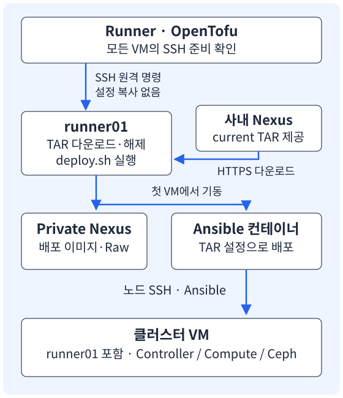

<section class="editorial-summary editorial-summary--text-only" aria-labelledby="editorial-summary-title">
  <div class="editorial-summary-layout">
    <div class="editorial-summary-copy">
      <span class="editorial-summary-label">이 가이드의 흐름</span>
      <h2 id="editorial-summary-title" class="editorial-summary-title">VM 생성 다음에, TAR 준비와 Ansible 실행을 연결한다.</h2>
      <p>OpenTofu가 VM을 만들고 SSH로 접속할 수 있는지 확인한다. 첫 번째 VM에서 Nexus의 TAR를 다운로드하고 deploy.sh를 실행한다. 배포 컨테이너가 뜬 다음 inventory와 변수를 전달하고, 컨테이너 안에서 Ansible을 실행한다.</p>
    </div>
  </div>
  <p class="editorial-summary-result"><span><strong>VM → SSH 확인 → TAR → deploy.sh → 설정 전달 → Ansible</strong> 순서다. VM 생성과 클라우드 설치는 서로 다른 단계다.</span></p>
</section>

[2편](../design/2026-10-08-opentofu-vsphere-rocky.md)의 Rocky Linux 9.6 템플릿·NIC 5개·고정 IP 구성을 이어서 사용한다. 이번에는 OpenTofu의 SSH 실행 기능으로 **이미 만들어진 릴리스 패키지**를 설치한다. 패키지를 빌드하거나 Gitea의 릴리스 게시 로직을 변경하는 내용은 아니다.

---

## 1. 어디에서 무엇이 실행되는가

[{ .architecture-diagram }](../assets/opentofu-ansible/deploy-flow.svg)

| 위치 | 실행하는 일 |
| --- | --- |
| Runner 또는 OpenTofu 실행 서버 | vCenter에 VM 생성 요청, 각 VM에 SSH 연결, 설정 파일 전송 |
| 사내 Nexus | 다운로드할 `contrabass-engine.tar` 제공 |
| 첫 번째 VM `runner01` | TAR 다운로드·해제, `deploy.sh`, Private Nexus·배포 컨테이너 실행 |
| `okestro-os-ansible` 컨테이너 | `~/okestro/okestro-openstack`에서 Ansible 실행 |
| 나머지 VM과 `runner01` | inventory에 지정된 Controller·Compute·Ceph 등의 역할 설치 |

`runner01`은 별도 관리 서버로 빠지는 것이 아니다. Deploy Node를 겸하면서 OpenStack 클러스터에도 포함된다. 네 VM 예제라면 앞 3대는 Controller+Compute+Ceph, 마지막 1대는 Compute+Ceph OSD로 구분한다. 실제 역할은 inventory와 playbook이 결정한다.

**vCenter API와 VM SSH는 다른 연결이다.** VM 생성은 vCenter에 요청하지만, TAR 다운로드 명령은 `runner01`의 셸에서 실행한다. 큰 TAR를 Runner에 받은 뒤 다시 VM으로 복사하지 않는다.

---

## 2. OpenTofu의 SSH 실행 기능 이해하기

**Provisioner**는 리소스 생성에 이어 명령이나 파일 전송을 실행하는 기능이다. 여기서는 두 가지만 사용한다.

| 기능 | 이 예제에서 하는 일 |
| --- | --- |
| `remote-exec` | VM에서 셸 명령 실행 |
| `file` | Runner의 설정 파일을 VM으로 전송 |
| `terraform_data` | VM과 별도로 설치 단계의 실행·재실행을 관리하는 기본 리소스 |

`terraform_data`는 VM을 만드는 Provider가 아니다. 별도 Provider 설치 없이 실행 단계를 담는 용도로 사용한다. 설치에 실패해도 **배포 단계만 다시 실행**할 수 있도록 VM 리소스와 분리한다. [terraform_data](https://opentofu.org/docs/v1.10/language/resources/tf-data/)

OpenTofu는 셸 명령의 내부 동작까지 선언형으로 관리하지 못한다. 공식 문서도 Provisioner를 마지막 수단으로 안내한다. 이 예제는 기존 `deploy.sh`와 Ansible 명령을 OpenTofu 실행 흐름에 연결하려는 실습이다. [Provisioner 사용 기준](https://opentofu.org/docs/v1.10/language/resources/provisioners/syntax/)

!!! warning "plan에는 셸 명령의 실제 영향이 모두 나오지 않는다"
    VM 생성·교체 대상은 plan에서 확인할 수 있지만, deploy.sh나 Ansible이 변경할 서비스·디스크의 상세 목록까지 OpenTofu가 계산하지는 않는다. 이 실습은 전용 테스트 VM을 대상으로 한다. 설치 명령과 inventory도 함께 검토한다.

---

## 3. 실행 전에 준비할 것

<p class="subsection-title"><strong>3-1. VM과 연결 준비</strong></p>

<div class="section-body" markdown="1">

- 2편의 VM 생성·NIC·고정 IP 설정을 완료한다. VM 이름은 그대로 유지한다.
- Runner의 공개키가 모든 VM의 `root` 계정에 등록돼 있어야 한다.
- Runner에서 VM의 관리 IP로 SSH 연결이 가능해야 한다.
- `runner01`에서 사내 Nexus 다운로드 주소에 접근할 수 있어야 한다.
- TAR 해제 공간, Nexus 데이터 공간, containerd 이미지 공간을 확보한다.
- 기존 Nexus·배포 컨테이너가 없는 전용 테스트 VM으로 시작한다.

게스트에는 아래 명령이 필요하다. **템플릿 준비 시** 확인하고, 빠졌다면 템플릿 또는 복제 VM의 관리 경로에서 설치한다. `scp`는 `openssh-clients` 패키지에 들어 있다.

```bash title="Rocky 게스트 — 명령 준비"
sudo dnf install -y openssh-clients curl tar gzip coreutils
command -v bash scp curl tar sha256sum timeout
```

OpenTofu의 SSH Provisioner는 명령 실행에도 스크립트를 업로드한다. SSH 서버만 있고 `scp`가 없다면 이 과정에서 실패할 수 있다. [SSH 연결과 SCP 조건](https://opentofu.org/docs/v1.10/language/resources/provisioners/connection/#executing-scripts-using-sshscp)

VMware Tools 초기화 스크립트를 사용한 구성에서는 `/var/log/opentofu-guest-init.log`의 `guest-init complete`를 확인한다. 아래 코드는 이 완료 표시까지 기다린다. 다른 초기화 방식을 쓰는 템플릿이라면 그 방식의 준비 완료 조건으로 바꾼다.

</div>

<p class="subsection-title"><strong>3-2. TAR와 설치 조건</strong></p>

<div class="section-body" markdown="1">

예제의 다운로드 파일명은 **`contrabass-engine.tar`**다. Nexus의 현재 다운로드 주소를 `bundle_url`에 넣는다. HTTPS 리다이렉트가 있으면 `curl -L`로 따라간다.

아래 URL은 공개용 예시다. 주소·Repository·경로는 실제 TAR를 받는 URL로 바꾼다. `current/stable` 자체가 Nexus의 기본 기능이라는 뜻은 아니다.

```text
https://nexus.example.com/repository/raw-manifest/current/stable/contrabass-engine.tar
```

**같은 다운로드 주소라도 다음 릴리스가 나오면 내용은 달라진다.** 실행할 TAR의 SHA256을 `bundle_sha256`으로 함께 고정한다. 다운로드 중 현재 버전이 바뀌면 해시 불일치로 중단한다. 자동 검증 파이프라인에서는 특정 버전·staging 산출물의 고정 URL을 넣는 편이 명확하다.

TAR 내부는 아래 구성을 전제로 한다. 다운로드 파일명과 내부 최상위 디렉터리명은 서로 다를 수 있다. `tar -tf`로 실제 내부 이름을 확인하고 `bundle_dir_name`을 맞춘다.

```text
contrabass-engine-deploy/
├── deploy.sh
├── SHA256SUMS
├── setup-private-environment.sh
├── release-images.tar
├── ... Nexus 이미지·Raw 파일 등 패키지 재료
└── git/init-container/contrabass-engine/
    ├── install.sh
    ├── containerd.service
    └── okestro/okestro-openstack/
        ├── main.yml
        └── inventory/
            ├── inventory.ini
            └── group_vars/all/main.yml
```

`deploy.sh <Deploy VM IP> --accept-eula`는 Private Nexus와 배포 컨테이너를 준비한다. **Ansible 전체 배포는 그다음에 실행한다.** `--accept-eula`는 Nexus 라이선스에 동의한다는 옵션이므로 동의한 경우에만 아래 설정을 켠다.

</div>

<p class="subsection-title"><strong>3-3. SSH 연결은 두 종류다</strong></p>

<div class="section-body" markdown="1">

1. **Runner → VM**: 2편에서 등록한 공개키를 사용한다.
2. **배포 컨테이너 → 각 노드**: Ansible 코드의 SSH 초기화 방식에 맞춰 준비한다.

Runner의 키가 VM에 들어갔다고 컨테이너까지 자동으로 그 키를 사용하는 것은 아니다. 사용하는 playbook의 `ssh-copy` 역할이 `server_password`로 키를 배포한다면, 해당 값과 노드의 비밀번호 접속 조건을 맞춘다. 이미 다른 키 배포 방식을 사용한다면 그 방식에 맞춘다. 컨테이너가 노드에 접속할 수 없는 상태에서는 전체 배포를 시작하지 않는다.

</div>

---

## 4. inventory와 main.yml 준비

2편의 OpenTofu 프로젝트에 `site/`를 추가한다. 여기에 **배포할 TAR와 같은 릴리스의 Ansible 설정 파일 전체**를 준비한다. 기존 설정을 복사한 뒤 테스트 환경 값만 수정한다.

```bash title="Runner — 사용 중인 Ansible 소스에서 설정 복사"
mkdir -p site
read -r -p '같은 릴리스의 okestro-openstack 소스 경로: ' ANSIBLE_SOURCE
test -f "${ANSIBLE_SOURCE}/inventory/inventory.ini"
test -f "${ANSIBLE_SOURCE}/inventory/group_vars/all/main.yml"
cp "${ANSIBLE_SOURCE}/inventory/inventory.ini" site/inventory.ini
cp "${ANSIBLE_SOURCE}/inventory/group_vars/all/main.yml" site/main.yml
chmod 600 site/inventory.ini site/main.yml
```

`site/main.yml`은 **변수 파일**이다. Ansible이 실행할 최상위 playbook `okestro-openstack/main.yml`과 이름이 같지만 다른 파일이다.

| Runner에서 준비한 파일 | VM에서 덮어쓸 파일 |
| --- | --- |
| `site/inventory.ini` | TAR 내부 `inventory/inventory.ini` |
| `site/main.yml` | TAR 내부 `inventory/group_vars/all/main.yml` |

파일을 준비하는 시점과 **VM에 적용하는 시점**도 구분한다. 아래 실행 순서는 deploy.sh로 컨테이너를 먼저 띄운 후, 컨테이너에 연결된 호스트 소스 경로에 두 파일을 전송한다.

<details class="analysis-toggle" markdown="1">
<summary>고정 IP와 역할을 설정 파일에 연결하는 예시</summary>

VM 이름과 Ansible inventory 별칭이 같을 필요는 없다. 기존 그룹·별칭을 유지하면서 관리 IP를 연결할 수 있다. 주소는 2편의 공개용 `/25` 예제를 사용한다.

| VM | inventory 별칭 | 관리 IP | 역할 |
| --- | --- | --- | --- |
| runner01 | contrabass01 | 192.0.2.101 | Deploy+Controller+Compute+Ceph |
| runner02 | contrabass02 | 192.0.2.102 | Controller+Compute+Ceph |
| runner03 | contrabass03 | 192.0.2.103 | Controller+Compute+Ceph |
| runner04 | contrabass04 | 192.0.2.104 | Compute+Ceph OSD |

아래는 관련 부분만 발췌한 예시다. 기존 `openstack`, `storage`, `osds`, `rgws` 등 필요한 그룹을 지우지 않는다. Ceph OSD 장치는 실제 테스트 디스크를 확인해 별도로 지정한다.

```ini title="site/inventory.ini — 관련 부분"
[alls]
contrabass01 ansible_host=192.0.2.101 ansible_user=root
contrabass02 ansible_host=192.0.2.102 ansible_user=root
contrabass03 ansible_host=192.0.2.103 ansible_user=root
contrabass04 ansible_host=192.0.2.104 ansible_user=root
deploy ansible_host=localhost ansible_user=root

[controller]
contrabass01
contrabass02
contrabass03

[compute]
contrabass01
contrabass02
contrabass03
contrabass04

[deploy_node]
deploy

[mons]
contrabass01 monitor_addresses=203.0.113.101
contrabass02 monitor_addresses=203.0.113.102
contrabass03 monitor_addresses=203.0.113.103
```

`site/main.yml`에는 기존 변수 전체를 유지하면서 NIC·VIP·Nexus 주소·접속 조건 등을 맞춘다. 아래 두 줄만으로 완성된 변수 파일을 만드는 것은 아니다.

```yaml title="site/main.yml — 변수 일부"
int_api_interface: ens33
nexus_url: "192.0.2.101:8443"
```

`nexus_url`은 Ansible 코드가 사용하는 기존 변수 형식을 따른다. 이 구성에서는 주소와 포트만 지정하며, 환경변수 `NEXUS_URL`을 추가로 넘기지 않는다. 내부망·모니터링·Ceph NIC와 provider uplink, VIP, DNS 등 나머지 값도 코드의 변수명에 맞춘다.

Rocky VM이 부팅됐다는 사실과 모든 Ansible 역할의 Rocky 지원은 별개다. 배포할 역할의 OS 조건·패키지 경로를 확인한다.

</details>

비밀번호가 들어 있는 설정 파일은 공개 Git에 올리지 않는다. `site/`, 상태·계획 파일, 개인키는 접근 권한을 제한해 관리한다.

---

## 5. OpenTofu에 배포 단계 추가

2편의 `.tf` 파일과 `lab.tfvars`는 유지한다. 같은 프로젝트에 아래 3개 파일과 `site/`를 더한다. 새 VM 리소스를 중복 선언하지 않는다.

```text
vmware-lab/
├── main.tf                         # 2편의 VM 생성 코드
├── variables.tf                    # 2편의 VM 입력값
├── ... 나머지 2편 프로젝트 파일
├── deployment-variables.tf          # TAR·Deploy VM·SSH 입력값
├── deployment.tf                    # SSH 확인 → 준비 → Ansible 순서
├── prepare-deploy.sh.tftpl          # 첫 VM에서 실행할 준비 스크립트
└── site/
    ├── inventory.ini               # 설정 파일 전체
    └── main.yml                    # group_vars 변수 파일 전체
```

<p class="subsection-title"><strong>5-1. deployment-variables.tf</strong></p>

<div class="section-body" markdown="1">

URL은 사내 Nexus, Private Nexus의 주소는 첫 VM의 관리 IP다. 주소의 역할을 혼동하지 않는다.

```hcl title="deployment-variables.tf"
variable "deploy_vm_name" {
  type    = string
  default = "runner01"
}

variable "ssh_private_key_path" {
  type = string
}

variable "bundle_url" {
  type = string

  validation {
    condition     = startswith(var.bundle_url, "https://")
    error_message = "다운로드할 TAR의 전체 HTTPS URL을 지정한다."
  }
}

variable "bundle_sha256" {
  type = string

  validation {
    condition     = can(regex("^[0-9a-f]{64}$", var.bundle_sha256))
    error_message = "대상 TAR의 SHA256을 소문자 64자리로 지정한다."
  }
}

variable "bundle_dir_name" {
  type    = string
  default = "contrabass-engine-deploy"

  validation {
    condition     = can(regex("^[a-zA-Z0-9_-]+$", var.bundle_dir_name))
    error_message = "TAR 내부 최상위 디렉터리 이름을 지정한다. 경로는 넣지 않는다."
  }
}

variable "accept_nexus_eula" {
  type    = bool
  default = false
}
```

`deploy_vm_name`은 VM 생성 순번을 추측하지 않고 이름으로 지정한다. `runner01`을 첫 번째 Deploy Node로 사용할 때 그대로 둔다. VM이 3개든 4개든 목록에 그 이름이 있으면 된다.

</div>

<p class="subsection-title"><strong>5-2. prepare-deploy.sh.tftpl</strong></p>

<div class="section-body" markdown="1">

OpenTofu가 이 파일을 읽어 값을 넣고 `runner01`로 전달한다. `/opt/contrabass-lab/<TAR SHA256>/`에 다운로드·해제하므로 같은 TAR의 실패 재실행은 같은 작업 경로를 사용한다.

<details class="analysis-toggle" markdown="1">
<summary>TAR 다운로드·해제와 deploy.sh 실행 코드</summary>

```bash title="prepare-deploy.sh.tftpl"
#!/bin/bash
set -euo pipefail
umask 077

work_dir='${work_dir}'
bundle_dir='${bundle_dir}'
expected_sha='${bundle_sha256}'
deploy_ip='${deploy_ip}'
bundle_url="$(printf '%s' '${bundle_url_b64}' | base64 -d)"
archive="$work_dir/contrabass-engine.tar"

mkdir -p "$work_dir"
cd "$work_dir"

if [[ ! -f "$archive" ]] ||
   ! printf '%s  %s\n' "$expected_sha" "$archive" | sha256sum --status -c -; then
  curl -kfsSL --retry 3 "$bundle_url" -o "$archive.part"
  printf '%s  %s\n' "$expected_sha" "$archive.part" | sha256sum -c -
  mv "$archive.part" "$archive"
fi

if [[ ! -f "$work_dir/.unpacked" ]]; then
  tar -xf "$archive" -C "$work_dir"
  test -f "$bundle_dir/deploy.sh"
  test -f "$bundle_dir/SHA256SUMS"
  touch "$work_dir/.unpacked"
fi

cd "$bundle_dir"
if [[ ! -f "$work_dir/.services-ready" ]]; then
  bash ./deploy.sh "$deploy_ip" --accept-eula
fi
nerdctl exec nexus true
nerdctl exec okestro-os-ansible true
curl -kfsS "https://$deploy_ip:8443/service/rest/v1/status" >/dev/null
touch "$work_dir/.services-ready"
```

- `-f`: HTTP 오류 페이지를 TAR로 저장하지 않는다.
- `-L`: 다운로드 주소의 리다이렉트를 따른다.
- `-k`: 이 자체 서명 인증서 실습에서는 인증서 검증을 생략한다. CA를 신뢰하는 환경은 제거한다.
- 외부 TAR 해시 검증 후 해제한다. 내부 `SHA256SUMS` 검사는 패키지의 deploy.sh가 호출하는 준비 단계에서 수행한다.
- `.unpacked`는 해제 후 필수 파일이 확인되면 만든다. 설정 파일을 수정한 뒤 원본을 다시 풀어 덮어쓰지 않도록 한다.
- `.services-ready`는 deploy.sh와 서비스 확인이 끝난 뒤 만든다. 그다음부터는 서비스를 확인하고, 이미 수정한 설정 파일을 원본 체크섬으로 다시 검사하는 설치 단계는 건너뛴다.

완료 표시가 없다면 해당 준비 단계를 다시 진행할 수 있다. 표시는 모든 Ansible 배포가 끝났다는 뜻이 아니다. 표시가 있어도 컨테이너·API가 정상이 아니면 실패한다. 기존 Nexus 데이터를 자동 삭제하거나 컨테이너를 강제 교체하지 않는다.

</details>

</div>

<p class="subsection-title"><strong>5-3. deployment.tf</strong></p>

<div class="section-body" markdown="1">

실행 단계를 세 리소스로 나눈다. `depends_on`은 앞 단계가 끝난 뒤 다음 단계를 실행하도록 연결한다.

| 리소스 | 실행 위치·역할 |
| --- | --- |
| `terraform_data.ssh_ready` | 모든 VM에 SSH 접속, 게스트 초기화 완료 확인 |
| `terraform_data.prepare_deploy` | 첫 VM에서 TAR 다운로드·해제·deploy.sh |
| `terraform_data.ansible_deploy` | 설정 파일 전송 후 컨테이너 안에서 Ansible |

<details class="analysis-toggle" markdown="1">
<summary>deployment.tf 전체 코드</summary>

```hcl title="deployment.tf"
locals {
  deploy_ip   = var.vms[var.deploy_vm_name].ipv4_addresses[0]
  work_dir    = "/opt/contrabass-lab/${var.bundle_sha256}"
  bundle_dir  = "${local.work_dir}/${var.bundle_dir_name}"
  ansible_dir = "${local.bundle_dir}/git/init-container/contrabass-engine/okestro/okestro-openstack"

  prepare_script = templatefile("${path.module}/prepare-deploy.sh.tftpl", {
    work_dir       = local.work_dir
    bundle_dir     = local.bundle_dir
    bundle_sha256  = var.bundle_sha256
    deploy_ip      = local.deploy_ip
    bundle_url_b64 = base64encode(var.bundle_url)
  })
}

resource "terraform_data" "ssh_ready" {
  for_each = var.vms

  triggers_replace = vsphere_virtual_machine.vm[each.key].id

  connection {
    type        = "ssh"
    host        = each.value.ipv4_addresses[0]
    user        = "root"
    private_key = file(pathexpand(var.ssh_private_key_path))
    agent       = false
    timeout     = "10m"
  }

  provisioner "remote-exec" {
    inline = [
      "#!/bin/bash",
      "set -euo pipefail",
      "for attempt in $(seq 1 120); do",
      "  if grep -qx 'guest-init complete' /var/log/opentofu-guest-init.log 2>/dev/null; then exit 0; fi",
      "  sleep 5",
      "done",
      "echo 'Guest initialization did not complete' >&2",
      "exit 1"
    ]
  }
}

resource "terraform_data" "prepare_deploy" {
  depends_on = [terraform_data.ssh_ready]

  triggers_replace = {
    vm_id       = vsphere_virtual_machine.vm[var.deploy_vm_name].id
    script_hash = sha256(local.prepare_script)
  }

  lifecycle {
    precondition {
      condition     = var.accept_nexus_eula
      error_message = "Nexus 라이선스 동의 후 accept_nexus_eula를 true로 지정한다."
    }
  }

  connection {
    type        = "ssh"
    host        = local.deploy_ip
    user        = "root"
    private_key = file(pathexpand(var.ssh_private_key_path))
    agent       = false
    timeout     = "10m"
  }

  provisioner "file" {
    content     = local.prepare_script
    destination = "/root/prepare-contrabass.sh"
  }

  provisioner "remote-exec" {
    inline = [
      "#!/bin/bash",
      "set -euo pipefail",
      "chmod 700 /root/prepare-contrabass.sh",
      "bash /root/prepare-contrabass.sh"
    ]
  }
}

resource "terraform_data" "ansible_deploy" {
  depends_on = [terraform_data.prepare_deploy]

  triggers_replace = {
    preparation_id = terraform_data.prepare_deploy.id
    vm_ids         = { for name, vm in vsphere_virtual_machine.vm : name => vm.id }
    inventory_hash = filesha256("${path.module}/site/inventory.ini")
    settings_hash  = filesha256("${path.module}/site/main.yml")
  }

  connection {
    type        = "ssh"
    host        = local.deploy_ip
    user        = "root"
    private_key = file(pathexpand(var.ssh_private_key_path))
    agent       = false
    timeout     = "10m"
  }

  provisioner "file" {
    source      = "${path.module}/site/inventory.ini"
    destination = "${local.ansible_dir}/inventory/inventory.ini"
  }

  provisioner "file" {
    source      = "${path.module}/site/main.yml"
    destination = "${local.ansible_dir}/inventory/group_vars/all/main.yml"
  }

  provisioner "remote-exec" {
    inline = [
      "#!/bin/bash",
      "set -euo pipefail",
      "chmod 600 '${local.ansible_dir}/inventory/inventory.ini' '${local.ansible_dir}/inventory/group_vars/all/main.yml'",
      "timeout 4h nerdctl exec okestro-os-ansible bash -lc 'cd /root/okestro/okestro-openstack && ansible-playbook -i inventory/inventory.ini main.yml' 2>&1 | tee /var/log/contrabass-ansible.log"
    ]
  }
}
```

`file`은 **호스트의 마운트 원본 경로**로 설정을 보낸다. 컨테이너의 `/root/okestro/okestro-openstack`이 위 `ansible_dir`을 bind mount한 구성이어야 한다. Bind mount는 호스트 디렉터리를 컨테이너 안에서 같은 내용으로 보는 연결이다. 코드 복사본을 컨테이너 안에 따로 만드는 방식과 다르다.

명령의 `~/okestro/okestro-openstack`은 컨테이너의 root 기준으로 `/root/okestro/okestro-openstack`이다. 그래서 실제 실행 명령은 다음과 같다.

```bash title="배포 컨테이너 안에서 실행되는 명령"
cd ~/okestro/okestro-openstack
ansible-playbook -i inventory/inventory.ini main.yml
```

`timeout 4h`는 예제의 설치 실행 제한이다. `connection.timeout = "10m"`은 SSH 연결 준비 시간이며 Ansible 실행 제한이 아니다. 장시간 배포라면 Workflow·Runner·셸 제한을 실제 배포 시간에 맞춘다. `pipefail`은 `tee`로 로그를 저장하더라도 설치 실패를 성공으로 숨기지 않게 한다.

개인키는 Runner의 파일에서 읽고, VM이나 배포 컨테이너로 복사하지 않는다. `connection`의 기본 SSH 호스트 키 검증은 비활성화돼 있다. 호스트 인증이 필요한 환경에서는 별도의 신뢰 절차와 `host_key`를 구성한다. [Connection](https://opentofu.org/docs/v1.10/language/resources/provisioners/connection/), [remote-exec](https://opentofu.org/docs/v1.10/language/resources/provisioners/remote-exec/), [file](https://opentofu.org/docs/v1.10/language/resources/provisioners/file/)

</details>

</div>

---

## 6. 실행하고 결과 확인하기

`lab.tfvars`에 아래 입력을 추가한다. 실제 Nexus URL과 Runner의 개인키 경로로 바꾼다. 개인키는 2편에서 VM에 등록한 공개키와 짝이 맞아야 한다.

```hcl title="lab.tfvars — 배포 입력 추가"
deploy_vm_name       = "runner01"
ssh_private_key_path = "/var/lib/gitea-runner/.ssh/id_ed25519"
bundle_url          = "https://nexus.example.com/repository/raw-manifest/current/stable/contrabass-engine.tar"
bundle_dir_name     = "contrabass-engine-deploy"

# Nexus 라이선스에 동의한 경우에만 켠다.
accept_nexus_eula = true
```

SHA256은 릴리스 게시 정보·체크섬에서 확인한 값을 입력한다. 임의 값을 넣거나 현재 주소의 파일 이름만 보고 판단하지 않는다. vCenter 인증 환경변수도 2편과 같이 준비한다.

```bash title="Runner — 해시 입력과 실행 계획"
read -r -p '배포할 TAR의 SHA256: ' TF_VAR_bundle_sha256
export TF_VAR_bundle_sha256

tofu fmt
tofu validate
tofu plan -var-file=lab.tfvars -out=deploy.tfplan
tofu show deploy.tfplan
```

기존 VM을 사용하는 경우에는 뜻하지 않은 VM 삭제·교체가 없는지 확인한다. 배포 단계 추가를 이유로 기존 VM 이름이나 State를 바꾸지 않는다. 계획을 저장한 뒤 `site/` 파일이나 배포 입력을 수정했다면 새 계획을 만든다. 검토한 계획을 적용한다.

```bash
tofu apply deploy.tfplan
```

실행 순서는 다음과 같다.

1. VM 생성 또는 기존 VM 상태 확인.
2. 모든 VM의 SSH 연결·게스트 초기화 완료 확인.
3. `runner01`에서 TAR 다운로드·SHA256 검증·압축 해제.
4. `deploy.sh` 실행으로 Private Nexus와 `okestro-os-ansible` 준비.
5. 컨테이너가 바라보는 inventory·group_vars 파일 전송.
6. 컨테이너 안에서 `ansible-playbook -i inventory/inventory.ini main.yml` 실행.

<details class="analysis-toggle" markdown="1">
<summary>설치 확인과 로그를 보는 명령</summary>

첫 VM의 호스트에서 확인한다. 아래 관리 IP는 2편 예제의 값이다.

```bash
ssh root@192.0.2.101
nerdctl ps
curl -kfsS https://192.0.2.101:8443/service/rest/v1/status
nerdctl inspect okestro-os-ansible
tail -n 80 /var/log/contrabass-ansible.log
```

bind mount 목적지가 `/root/okestro/okestro-openstack`인지 확인한다. 컨테이너에서 호스트 목록과 변수 파일을 읽을 수 있는지도 확인한다.

```bash
nerdctl exec okestro-os-ansible bash -lc \
  'cd /root/okestro/okestro-openstack && ansible-inventory -i inventory/inventory.ini --graph'
```

Ansible 종료 코드와 `PLAY RECAP`의 failed·unreachable 항목을 확인한다. Private Nexus 상태 조회 성공은 OpenStack 배포 성공을 뜻하지 않는다. Ansible 성공도 VM 인스턴스 생성 같은 서비스 기능 시험을 대체하지 않는다.

</details>

---

## 7. 실패·변경·재실행은 어떻게 처리되는가

**State**는 OpenTofu가 관리 대상과 실행 단계를 기억하는 기록이다. 셸 명령이 끝났다는 기록과 현재 서비스의 실제 상태는 같지 않을 수 있다.

| 상황 | 이 예제의 동작 |
| --- | --- |
| 최초 실행 | SSH 확인 → 준비 → 설정 전송·Ansible |
| 같은 설정으로 다시 apply | 실행 리소스에 변경이 없으면 Provisioner를 다시 실행하지 않음 |
| TAR 다운로드·deploy.sh 실패 | 준비 단계가 실패. 원인 수정 후 새 plan으로 재실행 |
| 설정 파일 내용 변경 | 파일 해시가 달라져 Ansible 단계 재실행 |
| VM이 새로 생성됨 | VM ID 변경을 감지해 관련 SSH·Ansible 단계 재실행 |
| 서비스가 나중에 중단됨 | State만으로 자동 감지하지 못함. 상태 확인 후 필요한 단계 재실행 |
| 현재 다운로드 주소의 TAR가 변경됨 | URL만 같으면 자동 감지하지 않음. 새 SHA256 입력과 새 plan 필요 |

실패한 Provisioner가 붙은 `terraform_data`는 다음 계획에서 교체 대상으로 표시될 수 있다. 여기서 교체는 **실행 단계의 기록을 다시 만드는 것**이지 VM 삭제를 뜻하지 않는다. 다만 VM 리소스 자체의 변경·실패 상태가 있는지는 plan에서 별도로 확인한다.

Ansible 단계만 다시 실행하려면 Runner의 같은 프로젝트에서 다음 계획을 만든다.

```bash title="설정·Ansible 단계만 재실행"
tofu plan -var-file=lab.tfvars \
  -replace=terraform_data.ansible_deploy \
  -out=retry-ansible.tfplan
tofu show retry-ansible.tfplan
tofu apply retry-ansible.tfplan
```

TAR 준비부터 다시 확인할 때는 `terraform_data.prepare_deploy`를 교체 대상으로 지정한다. 그 ID를 참조하는 Ansible 단계도 재실행 대상이 된다.

```bash title="TAR 준비부터 재실행"
tofu plan -var-file=lab.tfvars \
  -replace=terraform_data.prepare_deploy \
  -out=retry-prepare.tfplan
tofu show retry-prepare.tfplan
tofu apply retry-prepare.tfplan
```

!!! warning "새 TAR를 기존 클라우드 위에 설치하는 업그레이드 예제는 아니다"
    TAR 해시가 바뀌면 작업 디렉터리와 준비 단계도 바뀐다. 기존 Nexus 데이터나 컨테이너·클라우드를 자동 초기화하지 않는다. 새 릴리스 설치 시험은 별도 테스트 VM·State로 분리한다. 기존 서비스가 다른 이미지·소스 경로를 사용한다면 deploy.sh의 중단 조건을 확인한다.

해제 후 설정을 바꾸면 원래 `SHA256SUMS`와 다른 파일이 생기는 것은 자연스럽다. 최초 설치에서 내부 체크섬을 검사한 뒤 환경 설정을 적용한다. 준비 단계 재실행은 `.services-ready`가 있으면 서비스 상태를 확인하고 설치 스크립트를 생략한다. `.unpacked`·`.services-ready`는 설치 전체의 무결성 보증이나 드리프트 검사가 아니다.

`tofu destroy`는 관리하는 VM을 지우는 작업이다. 그 VM 안의 Nexus·배포 로그·데이터도 함께 사라진다. 필요한 로그를 먼저 가져오고 삭제 계획을 확인한다. State를 지워서 실패를 덮어두지 않는다.

---

## 8. 다음 검증 파이프라인으로 연결하기

이 글의 목표는 **VM 생성 이후 TAR 설치와 Ansible 실행 연결**이다. 서비스 기능 시험과 릴리스 승격은 별도 단계다.

<figure class="flow" aria-label="staging 패키지 설치 검증과 정식 릴리스 승격 흐름">
  <ol><li>staging TAR</li><li>테스트 VM 설치</li><li>기능 시험</li><li>통과 시 releases·current 갱신</li></ol>
</figure>

후속 자동화에서는 `bundle_url`을 이번 실행의 staging TAR로 지정한다. Ansible 배포와 기능 시험이 통과한 경우에만 정식 릴리스·다운로드 포인터를 갱신한다. 실패하면 기존 포인터를 유지하고, 로그를 수집한 뒤 테스트 VM과 staging 산출물을 정리한다.

OpenTofu는 VM 생성·삭제를 관리하고 시험 명령을 호출할 수 있지만, OpenStack 기능을 자동으로 판정해 주는 도구는 아니다. 확인할 기능과 통과 조건은 테스트 코드에서 정의한다.

---

## 9. 참고 자료

- [OpenTofu 입문 가이드 - 1](../design/2026-10-08-opentofu-basics.md)
- [OpenTofu 입문 가이드 - 2](../design/2026-10-08-opentofu-vsphere-rocky.md)
- [Provisioner 사용 기준](https://opentofu.org/docs/v1.10/language/resources/provisioners/syntax/)
- [terraform_data](https://opentofu.org/docs/v1.10/language/resources/tf-data/)
- [remote-exec](https://opentofu.org/docs/v1.10/language/resources/provisioners/remote-exec/)
- [file 전송](https://opentofu.org/docs/v1.10/language/resources/provisioners/file/)
- [SSH 연결·SCP 조건](https://opentofu.org/docs/v1.10/language/resources/provisioners/connection/)
- [실행 계획과 -replace](https://opentofu.org/docs/v1.10/cli/commands/plan/)
