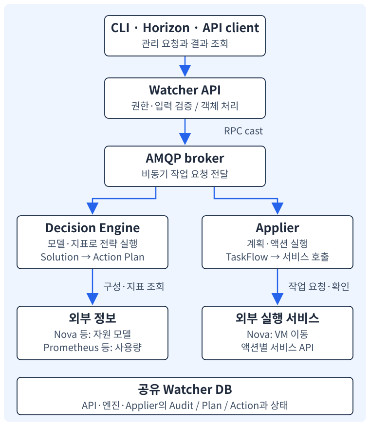

<section class="editorial-summary editorial-summary--text-only" aria-labelledby="editorial-summary-title">
  <div class="editorial-summary-layout">
    <div class="editorial-summary-copy">
      <span class="editorial-summary-label">이 구조의 핵심</span>
      <h2 id="editorial-summary-title" class="editorial-summary-title">요청을 받는 API, 계획을 만드는 엔진, 작업을 수행하는 Applier가 나뉜다.</h2>
      <p>Watcher를 이해하려면 프로세스와 업무 객체를 함께 봐야 한다. Audit는 분석 요청이고, Action Plan은 분석에서 나온 실행 계획이다. 둘은 별도의 상태와 생명주기를 가진다.</p>
    </div>
  </div>
  <p class="editorial-summary-result"><span>구성 요소를 연결하는 기준은 <strong>누가 어떤 정보를 읽고 무엇을 변경하는가</strong>이다.</span></p>
</section>

## 1. 프로세스 구성을 먼저 읽기

[1편](2026-11-02-watcher-epoxy-1-role.md)에서 본 최적화 흐름을 Watcher 14.2.0의 서비스에 연결하면 다음과 같다. 아래 그림은 역할을 설명하는 논리 구성도다. 실제 서버 배치나 수집한 통신 증적은 아니다.

[](../assets/watcher-epoxy/architecture.svg)

| 구성 요소 | 주된 책임 | 혼동하기 쉬운 점 |
| --- | --- | --- |
| Watcher API | REST 요청의 인증·권한·입력 검증, 객체 조회·생성·변경 | VM 이동을 API 요청 처리 안에서 끝내는 구성은 아님 |
| Decision Engine | 모델·지표를 바탕으로 전략 실행, 해법과 계획 생성 | 모델 안의 가상 이동은 실제 VM 이동과 다름 |
| Applier | 계획을 읽어 액션 실행, 상태·결과 기록 | Nova·Cinder 등의 실행 기능을 대신 구현하는 것은 아님 |
| Watcher DB | Audit·Plan·Action과 상태 등의 영속 저장 | 모든 원시 시계열을 모으는 저장소는 아님 |
| 메시지 브로커 | 서비스 간 RPC와 알림 전달 | 최적화 알고리즘을 수행하는 구성 요소는 아님 |
| 데이터 소스 | 전략이 필요한 사용량·온도 등의 지표 조회 | 노드·VM 인벤토리 모델과 구분 |

서버 소스에는 `watcher-api`, `watcher-decision-engine`, `watcher-applier` 실행 진입점이 등록돼 있다. API의 WSGI 진입점도 별도로 있다. `watcher-db-manage`는 DB 스키마 관리 명령이며 상시 실행하는 최적화 프로세스가 아니다. [실행 진입점 등록](https://github.com/openstack/watcher/blob/a5a9464fe7fbff91f723ec1676d7456847879768/setup.cfg)

여기서 RPC는 다른 서비스에 메서드 실행을 요청하는 방식이다. Watcher는 메시지 브로커를 통해 작업을 전달하며, AMQP는 이런 메시징에 사용하는 프로토콜이다. REST API는 외부 클라이언트의 HTTP 진입점이고, WSGI는 Python 웹 애플리케이션을 웹 서버에 연결하는 인터페이스다. 서로 같은 통신 계층을 뜻하는 용어가 아니다.

이름이 나뉘어 있다고 반드시 서버 세 대에 하나씩 설치해야 하는 것은 아니다. 프로세스 구분과 물리 배치는 다른 설계 문제다. 반대로 여러 서비스를 한 노드에 설치해도 논리적인 책임과 장애 구간은 나뉜다.

**인증도 두 방향으로 나뉜다.** 외부 사용자가 Watcher API를 호출할 때는 토큰·권한을 검증해야 한다. 반대로 Watcher가 Nova 등의 API를 조회·호출할 때는 서비스 측 인증이 필요하다. 설정의 `[keystone_authtoken]`과 `[watcher_clients_auth]`가 이 두 경계와 연결된다. Watcher API에 로그인할 수 있어도 Watcher의 Nova 호출 권한이 올바르다는 보장은 없다. [Epoxy 설정 설명](https://docs.openstack.org/watcher/2025.1/configuration/watcher.html)

## 2. 구성 정보와 사용량 정보를 나누는 이유

<p class="subsection-title"><strong>2-1. Cluster Data Model은 현재 구성을 표현한다</strong></p>

<div class="section-body" markdown="1">

Cluster Data Model, 줄여서 CDM은 Watcher가 판단에 사용하는 자원 모델이다. 컴퓨트 모델에서는 노드, VM, 두 자원의 연결 관계, 자원 크기와 상태 등을 표현한다.

예를 들어 “VM alpha는 compute-a에 있고 4 vCPU·8 GiB 메모리를 할당받았다”는 구성 정보다. “최근 5분간 VM alpha의 CPU 사용률”은 별도의 사용량 정보다.

Collector는 외부 서비스의 정보를 Watcher 모델로 옮기는 수집기다. 기본 플러그인에는 Nova 기반 `compute`, Cinder 기반 `storage`, Ironic 기반 `baremetal`이 등록돼 있다. 이 글의 예제는 compute 모델 중심이다. 이들 모두를 모든 전략에서 사용한다는 뜻은 아니다.

Collector는 서비스 API 조회와 알림 처리를 통해 모델을 관리하고 주기적으로 재구성한다. 전략에 제공하는 모델은 복사될 수 있으므로, 알고리즘이 그 안에서 VM을 옮겨 보는 행위가 실제 자원을 변경하지는 않는다. [Collector 기본 구현](https://github.com/openstack/watcher/blob/a5a9464fe7fbff91f723ec1676d7456847879768/watcher/decision_engine/model/collector/base.py), [Nova Collector](https://github.com/openstack/watcher/blob/a5a9464fe7fbff91f723ec1676d7456847879768/watcher/decision_engine/model/collector/nova.py)

</div>

<p class="subsection-title"><strong>2-2. Datasource는 필요한 지표를 조회한다</strong></p>

<div class="section-body" markdown="1">

Datasource는 전략이 쓰는 지표를 외부 백엔드에서 읽는 어댑터다. 예를 들어 Prometheus에 대해 “이 VM의 최근 300초 평균 CPU 사용률”을 조회한다. Watcher가 모든 계측기를 직접 배포하고 지표를 수집하는 것은 아니다.

모델에는 VM UUID와 노드 이름이 있고, 지표에는 라벨이 있다. 두 식별자가 연결돼야 “어느 자원의 사용량인지” 알 수 있다. 지표 자체가 존재해도 이 연결이 틀리면 전략이 쓸 수 없다.

또한 모델 갱신 시점, 지표 관측 시점, 계획 생성·실행 시점은 서로 다르다. VM이 방금 이동했다면 오래된 호스트 관계와 최신 CPU 지표가 섞일 수 있다. Watcher 모델을 외부 상태와 항상 동시에 갱신되는 단일 트랜잭션으로 이해해서는 안 된다.

</div>

## 3. Goal에서 Action까지 하나의 사례로 연결하기

예제의 목적은 부하 균형이다. 실제 클러스터에 객체를 생성한 결과가 아니라 용어의 관계를 설명하는 예시다.

| 객체·개념 | 의미 | 예제 |
| --- | --- | --- |
| Goal | 달성하려는 목적 | `workload_balancing` |
| Strategy | 목적을 위한 판단 알고리즘 | `workload_balance` |
| Audit Template | 목표·전략·범위 등을 재사용하는 분석 기준 | `study-balance` |
| Audit | 기준과 파라미터를 사용한 분석 요청 | CPU 기준, 300초 구간, ONESHOT |
| Solution | 전략이 만든 작업 후보와 효과 지표를 담는 내부 결과 | VM alpha를 a에서 b로 옮기는 후보 |
| Planner | 후보 작업을 실행 가능한 순서·의존 관계로 정리 | 이동 액션과 부모 액션 연결 |
| Action Plan | 저장된 실행 계획 | 특정 Audit에서 생성된 계획 |
| Action | 개별 작업과 입력값 | `migrate`, VM UUID, 출발지·목적지 |
| Efficacy Indicator | 해법의 효과를 표현하는 지표 | 전략이 계산한 이동 수·부하 관련 값 등 |

**Goal과 Strategy.** “부하 균형을 원한다”는 목적이고, 어떤 VM과 노드를 골라 옮길지는 전략의 판단이다. 같은 목적에 서로 다른 판단 방법이 연결될 수 있다.

**Audit Template과 Audit.** 템플릿은 재사용할 기준이고 Audit는 구체적인 분석 요청이다. 템플릿을 만들었다고 분석이나 이동이 즉시 실행되는 것은 아니다. Audit는 템플릿을 이용하거나 목표·전략 등을 직접 지정해 생성할 수 있다. 어느 방식이든 분석 파라미터와 분석 범위를 확인해야 한다. [Audit 요청 처리](https://github.com/openstack/watcher/blob/a5a9464fe7fbff91f723ec1676d7456847879768/watcher/api/controllers/v1/audit.py)

**Solution과 Action Plan.** 전략이 “이 VM을 이곳으로 옮기자”는 후보를 만들고, Planner가 저장할 Action들과 의존 관계를 구성한다. 내부 계산 결과인 Solution과 API로 조회하는 Action Plan을 같은 객체로 보면 처리 경계를 놓치기 쉽다. [Solution 구현](https://github.com/openstack/watcher/blob/a5a9464fe7fbff91f723ec1676d7456847879768/watcher/decision_engine/solution/default.py), [Weight Planner](https://github.com/openstack/watcher/blob/a5a9464fe7fbff91f723ec1676d7456847879768/watcher/decision_engine/planner/weight.py)

**효과 지표와 실측.** 계획에 기록된 효과 지표는 전략이 모델에서 계산한 결과일 수 있다. 이를 작업 이후 애플리케이션 성능을 측정한 결과로 읽으면 안 된다. 어떤 값이 계산됐는지는 전략 구현을 확인한다.

!!! note "문서의 액션 설명과 실제 등록 이름"
    일부 문서에는 VM 이동을 `migration`으로 설명한 표가 있지만, 14.2.0의 플러그인과 액션 타입 등록 이름은 `migrate`다. 실제 Action 출력과 소스를 연결할 때는 등록 이름을 기준으로 한다.

## 4. Scope와 파라미터는 서로 다른 제한이다

Scope는 분석할 클러스터 범위다. 예를 들어 특정 호스트 집합이나 aggregate 등으로 범위를 제한할 수 있다. 정확한 형식과 지원 항목은 해당 버전의 API·클라이언트와 모델 수집 방식을 함께 확인한다.

파라미터는 전략의 판단 기준이다. `workload_balance`의 `threshold`, `period`, `metrics`가 여기에 해당한다.

| 설정 | 답하는 질문 | 혼동하면 생기는 문제 |
| --- | --- | --- |
| Scope | 어디를 대상으로 분석할까? | 테스트 범위보다 넓은 자원을 분석 |
| Strategy parameters | 어떤 기준과 구간으로 판단할까? | 기대와 다른 임계값·지표로 계획 생성 |
| `auto_trigger` | 생성된 계획을 자동 실행할까? | 분석 요청만 의도했는데 실제 변경으로 연결 |
| Audit type·interval | 언제, 얼마나 자주 분석할까? | 반복 분석과 자동 실행을 같은 옵션으로 오해 |

Scope를 지정했다고 모든 운영 제약이 자동으로 해결되는 것은 아니다. VM 고정 정책, CPU·NUMA·PCI 장치, 네트워크·스토리지의 이동 조건 등은 실제 전략과 Nova 검증 범위를 함께 봐야 한다. 또한 Scope를 권한 경계나 프로젝트 격리 정책 전체의 대체물로 간주해서는 안 된다.

## 5. ONESHOT·CONTINUOUS·EVENT의 차이

| Audit 종류 | 분석 시작 방식 | 처음 이해할 때의 기준 |
| --- | --- | --- |
| ONESHOT | 요청에 따라 한 번 분석 | 단일 분석과 계획의 관계를 따라가기 쉬움 |
| CONTINUOUS | 설정된 간격·일정에 따라 반복 분석 | 새 계획과 이전 미실행 계획의 관계 확인 필요 |
| EVENT | 외부 이벤트 입력으로 분석 유발 | 이벤트 데이터·인증·대상 매핑이 별도로 필요 |

CONTINUOUS는 “반복 분석”이고 `auto_trigger`는 “계획 자동 실행”이다. 반복 분석을 하면서 계획은 사람이 검토하도록 둘 수도 있다. 14.2.0에서 `auto_trigger`의 API 기본값은 `False`다. 명시적으로 켠 환경에서는 분석과 실제 변경이 바로 이어질 수 있다.

14.2.0의 CONTINUOUS 처리에서는 같은 Audit의 이전 `RECOMMENDED` 계획을 새 분석 과정에서 `CANCELLED`로 바꾼다. 모든 과거 계획을 취소하거나 이미 진행 중인 migration을 되돌리는 동작으로 확대해 이해하면 안 된다. [반복 Audit 코드](https://github.com/openstack/watcher/blob/a5a9464fe7fbff91f723ec1676d7456847879768/watcher/decision_engine/audit/continuous.py)

## 6. 상태는 객체별로 읽는다

다음은 정상적인 ONESHOT 분석과 비어 있지 않은 계획의 대표 경로다. 가능한 모든 전이를 표현한 전체 상태도는 아니다.

```text
Audit       : PENDING → ONGOING → SUCCEEDED
Action Plan : RECOMMENDED → PENDING → ONGOING → SUCCEEDED
Action      : PENDING → ONGOING → SUCCEEDED
```

| 관찰한 상태 | 알 수 있는 것 | 이 상태만으로 알 수 없는 것 |
| --- | --- | --- |
| Audit `SUCCEEDED` | 분석·계획 생성 경로가 완료됨 | VM이 이미 이동했는지 |
| Plan `RECOMMENDED` | 검토·실행 대기 상태 | 실행 시점에도 계획이 유효한지 |
| Plan `ONGOING` | 실행 처리가 진행 중 | 모든 액션이 성공했는지 |
| Plan `SUCCEEDED` | 실행 처리의 성공 상태 또는 빈 계획의 성공 처리 | 실제 작업 유무와 성능 개선 여부 |
| Action `FAILED` | 개별 작업이 실패 상태로 기록됨 | 외부 자원이 완전히 원래 상태인지 |

빈 계획은 특히 주의해서 읽는다. 기본 Weight Planner는 액션이 하나도 없으면 계획을 `SUCCEEDED`로 저장한다. 따라서 성공 상태를 세는 것만으로 실제 migration 횟수를 산출할 수 없다. 액션 목록과 Nova의 실제 상태를 함께 확인해야 한다.

계획에는 `SUPERSEDED`, `CANCELLED`, `FAILED` 등의 상태도 있다. 생성 이후 실행하지 않은 계획에는 유효기간 문제도 있다. 14.2.0 설정의 `action_plan_expiry` 기본값은 24시간이며, 오래된 추천 계획을 무기한 유효한 승인서처럼 사용하지 않는다. 이 값은 실행 중인 migration의 제한시간이 아니다. [계획 상태·만료 처리](https://github.com/openstack/watcher/blob/a5a9464fe7fbff91f723ec1676d7456847879768/watcher/objects/action_plan.py), [Decision Engine 설정](https://github.com/openstack/watcher/blob/a5a9464fe7fbff91f723ec1676d7456847879768/watcher/conf/decision_engine.py)

## 7. Planner와 Workflow Engine은 다른 일을 한다

Planner는 실행 전에 작업의 의존 관계를 만든다. 기본 Weight Planner에서는 액션 종류별 weight와 parallelization 설정을 사용한다. weight는 어떤 종류의 액션을 먼저 배치할지, parallelization은 같은 종류를 어느 정도 병렬로 묶을지에 영향을 준다.

Workflow Engine은 Applier 안에서 그 계획을 실제 실행한다. 기본 구현은 TaskFlow를 사용한다. 액션의 `parents`로 표현된 의존 관계와 엔진 실행 설정에 따라 진행하므로, 모든 액션이 단순한 한 줄 목록으로 순차 실행되는 것은 아니다. [Workflow Engine](https://github.com/openstack/watcher/blob/a5a9464fe7fbff91f723ec1676d7456847879768/watcher/applier/workflow_engine/default.py)

TaskFlow는 작업과 의존 관계, 실패 시 되돌리기 등의 흐름을 실행하는 라이브러리다. VM 이동 대상을 정하는 전략 알고리즘과는 역할이 다르다. TaskFlow가 실행을 관리하더라도 Nova 작업 전체가 하나의 원자적 트랜잭션이 되는 것은 아니다.

예를 들어 “VM 이동 두 건을 병렬로 처리할 수 있다”는 계획과 “노드 전원을 끄기 전에 모든 VM 이동이 완료돼야 한다”는 제약은 다른 문제다. 기본 weight가 업무에 필요한 모든 의존 관계를 자동으로 보장한다고 가정하지 말고 최종 Action의 `parents`와 전략·Planner 구현을 확인해야 한다.

## 8. 패키징 전에 코드 위치와 책임 연결하기

지금은 코드를 수정할 단계가 아니라, 문제가 어느 계층에 있는지 찾는 지도를 만드는 단계다.

| 코드 영역 | 읽을 내용 | 관련 증상 예시 |
| --- | --- | --- |
| `watcher/api/controllers/v1/` | 입력·상태 변경·API 객체 변환 | 요청 거부, 파라미터 검증 실패 |
| `watcher/decision_engine/model/` | 구성 수집·모델·알림 반영 | VM 위치·호스트 상태가 기대와 다름 |
| `watcher/decision_engine/datasources/` | 지표 조회·변환 | 빈 지표, 라벨 불일치, 단위 오류 |
| `watcher/decision_engine/strategy/` | 후보 선택·해법 생성 | 계획 없음, 원하지 않는 후보 선택 |
| `watcher/decision_engine/planner/` | 순서·부모 액션·계획 저장 | 기대와 다른 실행 순서 |
| `watcher/applier/` | 실행·상태·실패 처리 | 계획 실행 실패, 일부 액션 실패 |
| `watcher/common/nova_helper.py` | Nova API 호출과 이동 결과 확인 | Watcher와 Nova 상태 연결 |

목표와 전략, 액션 등은 entry point로 등록된 플러그인이다. Python 클래스 파일이 존재하는지뿐 아니라 등록 메타데이터가 설치 결과에 포함됐는지도 나중의 패키징 검증 대상이 된다. 이 구조를 알면 “RPM 설치는 성공했는데 전략이 안 보인다”는 현상에서 확인할 위치를 좁힐 수 있다.

Entry point는 설치된 Python 패키지의 메타데이터에 이름과 구현 클래스를 연결해 두는 방식이다. Watcher는 stevedore 등의 로더로 이를 찾아 사용한다. 예를 들어 `workload_balance`라는 이름이 어떤 Python 클래스로 연결되는지를 등록 정보에서 확인할 수 있다.

## 9. 이해 확인과 이어 읽기

1. Audit Template을 만들면 바로 VM이 이동할까?
2. 모델 안에서 `migrate_instance`를 호출하는 것과 Applier의 `migrate` 액션은 무엇이 다를까?
3. CONTINUOUS와 `auto_trigger=True`는 같은 의미일까?
4. Plan이 `SUCCEEDED`인데 액션이 0개라면 무엇을 추가로 확인해야 할까?

다음 [3편 — Audit 한 건의 전체 처리 흐름](2026-11-02-watcher-epoxy-3-flow.md)에서는 UUID를 따라 API·RPC·전략·Planner·Applier를 연결한다.

**연재:** [1편 역할](2026-11-02-watcher-epoxy-1-role.md) · 2편 구조·용어 · [3편 요청 흐름](2026-11-02-watcher-epoxy-3-flow.md) · [4편 데이터·전략](2026-11-02-watcher-epoxy-4-metrics-strategies.md)

## 10. 참고 자료와 확인 범위

- [Epoxy 아키텍처와 상태도](https://docs.openstack.org/watcher/2025.1/architecture.html).
- [14.2.0 Audit 객체](https://github.com/openstack/watcher/blob/a5a9464fe7fbff91f723ec1676d7456847879768/watcher/objects/audit.py), [Action 객체](https://github.com/openstack/watcher/blob/a5a9464fe7fbff91f723ec1676d7456847879768/watcher/objects/action.py).
- [플러그인 개발 가이드](https://docs.openstack.org/watcher/2025.1/contributor/plugin/index.html).
- 소스 구조와 처리 조건을 대조한 개념 자료다. 실제 서비스 기동·API 호출·VM 이동은 수행하지 않았다.
