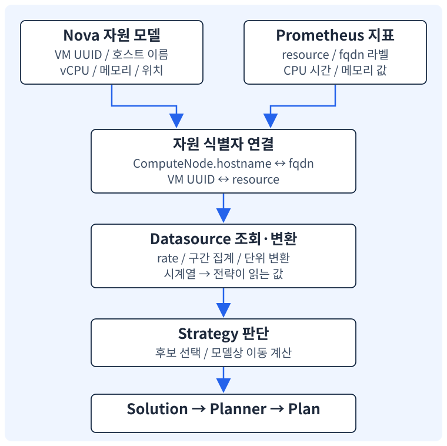

<section class="editorial-summary editorial-summary--text-only" aria-labelledby="editorial-summary-title">
  <div class="editorial-summary-layout">
    <div class="editorial-summary-copy">
      <span class="editorial-summary-label">이 판단의 핵심</span>
      <h2 id="editorial-summary-title" class="editorial-summary-title">지표가 존재하는 것과 전략이 올바르게 사용할 수 있는 것은 다르다.</h2>
      <p>Watcher는 VM과 호스트를 지표 라벨에 연결하고, 누적 카운터나 메모리 값을 전략이 기대하는 값으로 변환한다. Prometheus와 Thanos를 운영하고 있어도 지표 이름·단위·식별자·조회 API를 맞춰야 한다.</p>
    </div>
  </div>
  <p class="editorial-summary-result"><span>전략을 읽는 출발점은 <strong>무슨 데이터를 어떤 단위와 시간 구간으로 받아 어떤 액션을 만드는가</strong>이다.</span></p>
</section>

## 1. 모델과 지표가 연결돼야 판단할 수 있다

[3편](2026-11-02-watcher-epoxy-3-flow.md)에서는 요청 경로를 따라갔다. 이번에는 전략이 읽는 입력을 본다. 기준은 Watcher 14.2.0이며, 설명용 계산과 실제 운영 측정값을 구분한다.

[](../assets/watcher-epoxy/metric-join.svg)

| 정보 | 예시 | 제공하는 계층 |
| --- | --- | --- |
| 구성·관계 | VM alpha의 UUID, 위치, vCPU 수 | Nova 기반 compute 모델 |
| 원시 지표 | VM alpha의 누적 CPU 시간 | 계측·수집 체계와 Prometheus |
| 조회·변환 | 최근 구간의 CPU 시간 증가율을 사용률로 환산 | Prometheus datasource |
| 전략 판단 | 옮길 VM과 목적지 후보 선택 | Strategy |

Nova가 VM을 알고 Prometheus가 CPU 값을 가지고 있어도 둘을 같은 UUID로 연결하지 못하면 사용할 수 없다. VM 이름은 변경·중복될 수 있고, Prometheus의 기본 `instance` 라벨은 scrape 대상 주소를 뜻할 수 있다. OpenStack의 VM과 이름이 같다고 추정하지 않는다.

## 2. Watcher 지표 이름과 Prometheus 지표 이름은 다르다

전략은 `instance_cpu_usage` 같은 Watcher의 논리 지표 이름을 사용한다. Datasource는 이를 백엔드의 지표 이름과 조회 방식으로 연결한다. 14.2.0 Prometheus 구현의 주요 매핑은 다음과 같다.

| Watcher 논리 지표 | Prometheus 측 입력 | 14.2.0에서 읽는 방식 |
| --- | --- | --- |
| `host_cpu_usage` | `node_cpu_seconds_total` | idle 누적 시간의 증가율로 사용률 계산 |
| `host_ram_usage` | `node_memory_MemAvailable_bytes`와 `node_memory_MemTotal_bytes` | total에서 구간 집계 available을 빼고 1024로 나눔 |
| `instance_cpu_usage` | `ceilometer_cpu` | 누적 CPU 시간 증가율을 vCPU 수로 정규화 |
| `instance_ram_usage` | `ceilometer_memory_usage` | VM UUID로 고른 시계열을 시간 구간 집계 |
| `instance_ram_allocated` | 모델의 VM 메모리 값 | Prometheus 조회 대신 모델 값 반환 |
| `instance_root_disk_size` | 모델의 VM 디스크 값 | Prometheus 조회 대신 모델 값 반환 |
| `host_outlet_temp`·`host_power` 등 | 기본 매핑 `None` | 해당 구현의 기본 지원 범위 밖 |

표는 코드에 있는 기본 동작이다. 마지막 두 자원 크기는 METRIC_MAP 안에 이름이 있어도 실제 시계열을 조회하는 것이 아니라 모델 값으로 처리한다. “매핑에 있다”와 “Prometheus에 실제 지표가 있다”를 구분해야 한다. [PrometheusHelper 전체 구현](https://github.com/openstack/watcher/blob/a5a9464fe7fbff91f723ec1676d7456847879768/watcher/decision_engine/datasources/prometheus.py)

**node exporter와 VM 계측은 다른 입력이다.** node exporter의 호스트 CPU·메모리만으로 각 VM의 사용률은 분해할 수 없다. 이 버전의 기본 VM 지표 이름은 Ceilometer 계열의 Prometheus 지표를 전제로 한다. 다른 libvirt exporter에 CPU 값이 있더라도 이름·라벨·단위·정규화 방식이 맞는지부터 확인한다.

Epoxy에서 제거한 것은 기존 **Ceilometer API datasource**다. Ceilometer가 생성한 지표를 Prometheus에서 조회하는 경로까지 없어졌다는 뜻은 아니다. 이 차이는 [Epoxy 변경 사항](https://releases.openstack.org/epoxy/highlights.html#watcher)과 위 소스의 `ceilometer_cpu` 매핑을 함께 보면 분명해진다.

## 3. CPU 사용률을 직접 계산해 보기

<p class="subsection-title"><strong>3-1. 누적 카운터는 사용률이 아니다</strong></p>

<div class="section-body" markdown="1">

`ceilometer_cpu`는 이 구현에서 누적 CPU 시간(ns)으로 해석한다. 누적 시간이 큰 VM이 반드시 지금 더 바쁜 것은 아니다. 오래 실행한 VM은 단순히 누적값이 클 수 있다. 먼저 일정 구간에서 얼마나 증가했는지를 계산해야 한다.

Prometheus의 `rate()`는 구간에 걸친 초당 증가율을 계산하는 데 사용된다. Watcher는 이 값을 초 단위로 환산하고 VM의 vCPU 수로 나눠 전체 할당 vCPU 대비 사용률을 만든다. 아래는 계산 의미를 풀어 쓴 식이다.

```text
CPU 사용률(%)
  = 누적 CPU 시간의 초당 증가율(ns/s)
    ÷ 1,000,000,000(ns/s)
    ÷ VM vCPU 수
    × 100
```

예를 들어 **설명용으로** 4 vCPU VM이 300초 동안 960 CPU초를 사용했다고 하자. 초당 3.2 CPU초를 소비했으므로 `3.2 / 4 × 100 = 80%`다. 이는 VM 전체 할당 vCPU 대비 비율이며, 호스트 전체 CPU의 80%라는 의미는 아니다.

14.2.0은 결과를 `clamp_max(..., 100)`으로 제한한다. vCPU 수를 얻지 못하면 1로 가정하는 경로도 있다. 따라서 모델의 vCPU 정보가 틀리면 단위가 맞는 카운터라도 결과가 왜곡될 수 있다.

</div>

<p class="subsection-title"><strong>3-2. 실제 PromQL 형태</strong></p>

<div class="section-body" markdown="1">

아래는 `resource` 라벨, 4 vCPU, 300초 조건에 맞춰 14.2.0의 쿼리 생성 방식을 펼친 예시다. 실제 조회 결과는 아니다.

```promql
clamp_max(
  (
    avg by (resource) (
      rate(ceilometer_cpu{
        resource="11111111-1111-4111-8111-111111111111"
      }[300s])
    ) / 1e9
  ) * (100 / 4),
  100
)
```

호스트 CPU는 다른 식을 사용한다. 여러 CPU의 idle 증가율을 평균 내고 100에서 뺀다.

```promql
100 - (
  avg by (fqdn) (
    rate(node_cpu_seconds_total{
      mode="idle",
      fqdn="compute-a.example.com"
    }[300s])
  ) * 100
)
```

VM workload의 합과 호스트의 실제 CPU 사용률은 같을 필요가 없다. 호스트에는 VM 외 프로세스와 커널 작업도 있고, 측정 구간과 정규화 방식도 다를 수 있다. `workload_balance`의 CPU 모드가 어느 쪽 값을 쓰는지는 전략 코드를 확인해야 한다.

CPU 관련 식은 [쿼리 생성 코드](https://github.com/openstack/watcher/blob/a5a9464fe7fbff91f723ec1676d7456847879768/watcher/decision_engine/datasources/prometheus.py), `rate()`의 의미는 [Prometheus 공식 함수 문서](https://prometheus.io/docs/prometheus/latest/querying/functions/#rate)를 참고한다.

</div>

## 4. 메모리 지표와 시간 구간에서 주의할 점

CPU뿐 아니라 메모리도 단위와 의미가 맞아야 한다. 할당 메모리, 게스트가 사용한 메모리, 호스트의 available 메모리는 다른 값이다. 백엔드 이름만 바꿔 이 차이를 없앨 수는 없다.

특히 14.2.0의 호스트 RAM 쿼리는 bytes에서 사용량을 계산한 뒤 `/1024`를 적용하므로 결과 수치가 **KiB에 해당**한다. VM 메모리 쿼리는 `ceilometer_memory_usage`를 집계하고 별도의 단위 변환을 하지 않는다. 따라서 RAM 기반 전략을 도입할 때는 실제 지표 단위와 모델·전략의 단위를 대조해야 한다. 여기서는 이 조합의 RAM 연산을 운영 환경에서 검증하지 않았다.

| 시간 관련 값 | 의미 | 서로 바꿔 쓸 수 없는 이유 |
| --- | --- | --- |
| Prometheus `scrape_interval` | 원시 지표 수집 간격 | Watcher 분석 빈도와 별개 |
| 전략의 `period` | 지표를 읽는 시간 범위 | 300이면 보통 최근 300초를 고려 |
| `granularity` | datasource 공통 인터페이스의 집계 간격 인자 | Prometheus 구현은 해당 인자를 사용하지 않음 |
| CONTINUOUS `interval` | 분석을 반복하는 간격 | 이전 구간과 겹치는 관측으로 새 계획 생성 가능 |
| 모델 수집·동기화 주기 | 노드·VM 관계를 갱신하는 주기 | 사용량 수집 간격과 다른 축 |

300초 구간으로 30초마다 분석하면 겹치는 관측값을 반복 사용한다. 이것 자체가 오류는 아니지만, migration 효과가 지표에 반영되기 전에 다음 판단을 할 수 있다는 뜻이다. 수집 지연, 조회 지연, 계획 대기와 실행시간까지 고려해야 한다. 반복 분석을 빠르게 만드는 것만으로 더 정확한 판단이 되지는 않는다.

Prometheus datasource의 `statistic_series()`는 14.2.0에서 구현되지 않았고 `NotImplementedError`를 발생시킨다. 구간 집계인 `statistic_aggregation()`을 지원한다는 이유로 모든 시계열 기반 전략이 호환된다고 가정할 수 없다. 또한 `count` 집계는 이 구현에서 `avg`로 대체하고 경고를 기록한다. [Epoxy Prometheus 문서](https://docs.openstack.org/watcher/2025.1/datasources/prometheus.html), [집계 구현](https://github.com/openstack/watcher/blob/a5a9464fe7fbff91f723ec1676d7456847879768/watcher/decision_engine/datasources/prometheus.py)

## 5. 호스트와 VM 라벨을 맞추는 방법

14.2.0의 기본 식별 라벨은 호스트용 `fqdn`, VM용 `resource`다. 설정으로 키 이름을 바꿀 수 있지만 값은 모델의 실제 자원과 대응해야 한다.

| Watcher 모델 | Prometheus에서 대응할 값 | 기본 설정 키 |
| --- | --- | --- |
| `ComputeNode.hostname` | exporter가 속한 컴퓨트 호스트 이름 | `fqdn_label = fqdn` |
| VM의 `uuid` | VM 시계열의 OpenStack UUID | `instance_uuid_label = resource` |

다음은 호스트 식별자를 붙이는 scrape 설정의 일부 예시다. 문서용 주소이며 적용·수집 검증은 수행하지 않았다.

```yaml
scrape_configs:
  - job_name: node
    static_configs:
      - targets: ["192.0.2.10:9100"]
        labels:
          fqdn: compute-a.example.com
```

VM 지표는 각 VM UUID 라벨이 필요하다. node exporter target에 호스트 라벨을 추가했다고 VM UUID까지 생기는 것은 아니다. 다음은 라벨 구조만 보여 주는 설명용 표현이다.

```text
ceilometer_cpu{resource="11111111-1111-4111-8111-111111111111",...}
ceilometer_memory_usage{resource="11111111-1111-4111-8111-111111111111",...}
```

호스트 이름 해석도 완전히 자유로운 것은 아니다. 이 버전은 Prometheus의 active targets에서 `fqdn_label` 값을 모으고, 전체 이름과 첫 번째 점 앞의 짧은 이름을 매핑한다. 서로 다른 도메인에 같은 짧은 호스트 이름이 있으면 모호해질 수 있다. 모델 이름과 지표 이름을 일관되게 유지하는 편이 안전하다. 매핑 갱신도 코드 경로에 따라 발생하므로 “라벨만 수정하면 모든 캐시가 즉시 갱신된다”고 단정하지 않는다. [호스트 이름 해석 코드](https://github.com/openstack/watcher/blob/a5a9464fe7fbff91f723ec1676d7456847879768/watcher/decision_engine/datasources/prometheus.py)

개념상 필요한 Watcher 설정은 다음과 같다. 전체 설치 설정이 아니라 datasource 선택과 식별자 연결만 보여 준다.

```ini
[watcher_datasources]
datasources = prometheus

[prometheus_client]
host = prometheus-query.example.com
port = 9090
fqdn_label = fqdn
instance_uuid_label = resource
```

이 버전의 `host`는 호스트 이름 또는 IP를 받는다. `https://.../prometheus`처럼 스킴·경로를 포함한 URL을 그대로 넣는 형식이 아니다. 인증·TLS 설정은 `username`, `password`, `cafile`, `certfile`, `keyfile`과 사용 중인 `python-observabilityclient` 구현을 함께 확인한다. [설정 정의](https://github.com/openstack/watcher/blob/a5a9464fe7fbff91f723ec1676d7456847879768/watcher/conf/prometheus_client.py)

## 6. Thanos가 있으면 바로 연결할 수 있을까

Thanos Query는 Prometheus 호환 조회 API를 제공한다. 그러나 특정 Watcher 버전과 실제 Thanos 배포의 호환성은 **쿼리 성공 한 건**으로 확정할 수 없다. Watcher 14.2.0이 조회하는 경로와 기대 응답도 확인해야 한다.

| HTTP 경로 | Watcher에서 사용하는 목적 | 확인할 응답 |
| --- | --- | --- |
| `/api/v1/targets?state=active` | 초기화 시 호스트 라벨 목록 생성 | `data.activeTargets[].labels`에 필요한 호스트 라벨 |
| `/api/v1/query` | 사용량 PromQL 평가 | 기대한 자원의 값·개수·시각 |
| `/api/v1/label/__name__/values` | 지표 목록 확인 | 필요한 지표 이름 존재 |
| `/api/v1/status/runtimeinfo` | 가용성 확인 메서드에서 호출 | 접근·응답 가능 여부 |

모든 경로가 모든 조회에 항상 호출되는 것은 아니다. `targets`는 helper 초기화에 사용되고, `runtimeinfo`는 `check_availability()`가 호출되는 요구사항 확인 등의 경로에서 사용된다. Thanos Query·Query Frontend·프록시의 제공 범위와 뒤에 연결된 대상에 따라 응답을 직접 확인해야 한다. Thanos가 targets를 지원하지 않는다고 일반화하는 것도 맞지 않는다.

예를 들어 장기 저장 지표를 조회할 수 있어도, active targets에서 필요한 host 라벨을 얻지 못하면 모델과 호스트 지표의 연결은 실패할 수 있다. 반대로 API 경로가 모두 있어도 VM UUID 라벨이 틀리면 VM 지표를 찾지 못한다.

**다중 클러스터와 중복 시계열.** 여러 클러스터의 데이터를 한곳에서 조회한다면 호스트 이름의 전역 유일성과 클러스터 구분을 확인한다. 14.2.0의 호스트 쿼리는 설정한 호스트 라벨을, VM 쿼리는 UUID 라벨을 기준으로 만든다. 별도의 임의 tenant 헤더나 클러스터 필터가 자동으로 추가된다고 가정하지 않는다.

**HA 복제와 부분 응답.** Thanos의 중복 제거와 부분 응답 정책도 확인할 대상이다. HTTP 200이라도 일부 저장소가 누락된 응답일 수 있다. Watcher helper는 query 결과가 있으면 첫 번째 결과의 숫자를 반환하는 경로이므로, 중복 시계열이 남거나 원하는 자원만 선택되지 않은 상태를 무시할 수 없다. CPU 쿼리의 `avg by`가 일부 중복을 합칠 수는 있지만 이것을 의도한 HA 중복 제거의 대체물로 보지 않는다.

Thanos 자체의 기능은 [공식 Query 문서](https://thanos.io/tip/components/query.md/)를 참고한다. 이 글에서 실제 Thanos 버전, 배치 방식, 인증 프록시, tenant 정책은 확인하지 않았다. 따라서 위 내용은 호환성을 판정할 기준이며 연동 성공 기록이 아니다.

<details class="analysis-toggle" markdown="1">
<summary>Thanos·Prometheus 조회 경로를 어떻게 나눠 확인할까?</summary>

승인된 관리 단말에서 실제 검증용 API 주소로 바꿔 조회한다. `PROM_API`에는 스킴과 포트가 포함된 API 기본 주소를 넣는다. 아래 값은 예시이며 인증정보는 포함하지 않았다. 인증·TLS가 있으면 조직에서 승인한 클라이언트 인증 방식을 적용한다.

```bash
PROM_API='https://metrics.example.com'

curl --fail-with-body --silent --show-error \
  "$PROM_API/api/v1/targets?state=active"

curl --fail-with-body --silent --show-error \
  "$PROM_API/api/v1/status/runtimeinfo"

curl --fail-with-body --silent --show-error \
  "$PROM_API/api/v1/label/__name__/values"
```

상태코드만 보지 않고 JSON의 `status`, `data`, `warnings`와 실제 라벨을 읽는다. 대상 목록에서는 compute 호스트가 반환되는지 확인한다. 지표 이름 목록이 있다고 개별 VM의 최신 시계열이 존재하는 것은 아니다.

가용성 조회 다음에는 `query`에 실제 필요한 PromQL을 전달한다. 다음은 형식을 보여 주는 호스트 지표 조회 예시다. `up` 결과만 확인하는 것보다 어떤 원시 시계열과 라벨이 있는지 읽는 데 도움이 된다.

```bash
curl --fail-with-body --silent --show-error --get \
  "$PROM_API/api/v1/query" \
  --data-urlencode 'query=node_cpu_seconds_total{mode="idle",fqdn="compute-a.example.com"}'
```

같은 방법으로 실제 VM UUID의 `ceilometer_cpu`와 `ceilometer_memory_usage`, 그리고 전략이 사용할 변환 쿼리까지 확인한다. 필요한 샘플 수·신선도·단위·조회 범위를 검증한 뒤 datasource의 실제 반환값과 비교한다. 이 명령들의 실행 결과는 이 글에 포함하지 않았다. API 형식은 [Prometheus HTTP API](https://prometheus.io/docs/prometheus/latest/querying/api/)가 기준이다.

</details>

## 7. workload_balance를 수치로 따라가기

이 전략의 CPU 모드는 VM별 사용량을 합쳐 노드의 workload를 계산하고, 임계값 이상 노드에서 VM 한 대를 골라 더 여유 있는 노드로 옮기는 해법을 찾는다. 호스트의 node exporter CPU값을 그대로 사용하는 방식과 다르다.

**입력 파라미터.** 14.2.0 스키마 기준 기본값이다. 운영 권장값을 의미하지 않는다.

| 파라미터 | 기본값 | 뜻 |
| --- | --- | --- |
| `metrics` | `instance_cpu_usage` | CPU 또는 RAM 중 판단에 쓸 VM 지표 |
| `threshold` | `25.0` | 노드 부하를 구분하는 임계값 |
| `period` | `300` | 사용량 조회 시간 범위(초) |
| `granularity` | `300` | 공통 집계 인자. Prometheus helper에서는 미사용 |

**계산 순서.** 코드의 주요 메서드와 연결하면 다음과 같다.

1. `get_available_compute_nodes()`: 모델에서 ONLINE·ENABLED 노드를 고른다.
2. `group_hosts_by_cpu_or_ram_util()`: 각 VM의 사용량을 조회하고 노드별 합계·클러스터 평균을 계산한다.
3. `choose_instance_to_migrate()`: 과부하 노드에서 제외 대상이 아닌 ACTIVE VM 중 평균에 가까워지는 후보를 찾는다.
4. `filter_destination_hosts()`: vCPU·메모리·디스크 여유와 이동 후 부하 조건을 확인한다.
5. 목적지 후보를 부하순으로 정렬해 선택하고 Solution에 live `migrate`를 추가한다.

CPU 모드의 workload 단위는 사용률을 vCPU 수에 곱해 만든 CPU 개수 상당량이다. 식은 다음과 같다.

```text
VM workload = VM CPU 사용률(%) × VM vCPU 수 ÷ 100
노드 workload = 그 노드 VM들의 workload 합계
노드 사용률(%) = 노드 workload ÷ 노드 vCPU 수 × 100
```

이제 **계산 학습용 가상 값**으로 보자. 노드 세 대의 모델 vCPU 수는 모두 16, 임계값은 기본값 대신 70%로 두고, 이미 수집한 VM workload 합계가 아래와 같다고 가정한다.

| 노드 | VM workload 합계 | 계산한 노드 사용률 | 70% 기준 구분 |
| --- | --- | --- | --- |
| compute-a | 12.8 | 80% | 이동 출발지 후보 |
| compute-b | 3.2 | 20% | 목적지 후보 |
| compute-c | 3.2 | 20% | 목적지 후보 |

평균 workload는 `(12.8 + 3.2 + 3.2) / 3 = 6.4`다. 출발지 a가 평균을 초과한 양은 6.4다. 전략은 이동 후 평균에 가까워지되 후보 선택 식의 조건을 만족하는 VM을 찾는다.

여기서 a에 있는 4 vCPU·CPU 80% VM이 선택됐다고 가정하자. workload는 3.2다. b에 이 VM을 더하면 `(3.2 + 3.2) / 16 × 100 = 40%`이므로 70%보다 낮다. vCPU·메모리·디스크 여유도 충족한다면 목적지 후보가 될 수 있다. 모델상 a의 부하는 60%가 된다.

이는 특정 VM이 반드시 선택된다는 전체 시뮬레이션은 아니다. 다른 VM의 상태·workload·제외 설정에 따라 선택이 달라지고, b·c가 같은 값일 때 특정 노드 선택 순서를 일반적으로 보장하지도 않는다. 실제 목적지 자원과 Nova 이동 제약은 별도다.

**한 번에 한 VM.** 이 구현의 실행 경로는 한 번의 판단에서 migration 한 건을 추가한다. 모든 노드가 즉시 같은 부하가 되도록 여러 VM을 한꺼번에 재배치하는 알고리즘이 아니다. 반복 분석을 고려할 수 있지만, 이동 비용·수집 지연·왕복 이동 가능성을 먼저 검증해야 한다.

**계획이 비는 이유.** 임계값 이상 노드가 없거나, 임계값 미만 목적지가 없거나, 적절한 VM이 없거나, 목적지 자원이 부족하면 이동 없는 해법이 나올 수 있다. 지표 조회 실패·누락도 경로에 영향을 준다. 이 버전은 일부 VM의 지표 조회 실패를 기록하고 계속 진행하는 코드가 있어, 누락된 VM을 포함한 부하 해석을 주의해야 한다. 빈 계획을 “전 클러스터가 최적”이라는 증거로 사용하지 않는다.

[전략 14.2.0 구현](https://github.com/openstack/watcher/blob/a5a9464fe7fbff91f723ec1676d7456847879768/watcher/decision_engine/strategy/strategies/workload_balance.py), [Epoxy 전략 설명](https://docs.openstack.org/watcher/2025.1/strategies/workload_balance.html)

!!! warning "알고리즘의 적용 조건"
    해당 전략 설명에는 PoC 성격, 동질적인 CPU·메모리 구성, migration 가능성 등의 가정이 있다. 위 계산을 이해했다고 운영 투입 적합성까지 확인된 것은 아니다. NUMA·CPU pinning·PCI 장치·정책 등 실제 제약을 모두 대체하는 계산으로 사용하지 않는다.

## 8. 다른 전략은 무엇이 다를까

등록된 전략을 외우기보다 목적·필수 입력·작업 종류를 비교하면 이해하기 쉽다. 아래는 학습을 위한 주요 비교이며 전체 지원 목록은 아니다.

| 전략 | 주된 목적·판단 | 중요한 입력·가정 |
| --- | --- | --- |
| `workload_balance` | 임계값을 넘는 노드에서 단일 VM 이동 후보 탐색 | VM CPU·RAM 지표, 모델 자원, live migration |
| `workload_stabilization` | 부하의 표준편차 등을 고려해 균형화 | 호스트·VM 지표, 전략별 가중치·임계값 |
| `vm_workload_consolidation` | VM을 통합해 사용할 노드 수 조정 | 호스트·VM 부하와 할당 크기, 통합 이후 여유 |
| `host_maintenance` | 점검 대상 노드의 VM 이동 계획 | 점검 노드·선택적 backup 노드, VM 상태와 이동 가능성 |
| `outlet_temperature` | 배출 온도에 따른 이동 판단 | `host_outlet_temp` 등의 지원 지표 |
| `noisy_neighbor` | L3 캐시 사용량 기반 경합 판단 | `instance_l3_cache_usage` 등의 지원 지표 |

표준편차는 값들이 평균에서 얼마나 흩어져 있는지를 표현한다. 예를 들어 모든 노드가 비슷한 부하면 편차가 작다. 그러나 모든 노드가 동시에 과부하인 경우에도 편차는 작을 수 있다. 따라서 “편차를 줄인다”는 목적과 절대적인 여유 확보는 구분한다.

또한 `host_maintenance`는 부하 임계값을 넘은 호스트를 자동으로 찾는 것과 다른 문제다. 명시한 점검 대상의 VM 이동이 중심이다. 해당 전략에는 PoC와 migration 가능성 관련 제약도 명시돼 있다.

전략별 입력 선언은 [workload_stabilization](https://github.com/openstack/watcher/blob/a5a9464fe7fbff91f723ec1676d7456847879768/watcher/decision_engine/strategy/strategies/workload_stabilization.py), [VM 통합](https://github.com/openstack/watcher/blob/a5a9464fe7fbff91f723ec1676d7456847879768/watcher/decision_engine/strategy/strategies/vm_workload_consolidation.py), [호스트 점검](https://github.com/openstack/watcher/blob/a5a9464fe7fbff91f723ec1676d7456847879768/watcher/decision_engine/strategy/strategies/host_maintenance.py), [온도](https://github.com/openstack/watcher/blob/a5a9464fe7fbff91f723ec1676d7456847879768/watcher/decision_engine/strategy/strategies/outlet_temp_control.py), [경합](https://github.com/openstack/watcher/blob/a5a9464fe7fbff91f723ec1676d7456847879768/watcher/decision_engine/strategy/strategies/noisy_neighbor.py)에서 확인할 수 있다.

## 9. Datasource 선택과 지표 매핑에서의 함정

`DataSourceManager.get_backend()`는 설정 순서대로 데이터 소스를 검토하고, 전략이 선언한 지표의 매핑을 지원하는 백엔드를 찾는다. 같은 전략의 여러 지표를 각각 임의의 데이터 소스에서 하나씩 읽어 합치는 일반적인 방식으로 이해하면 안 된다.

`workload_balance`는 선언상 `instance_cpu_usage`와 `instance_ram_usage`를 모두 요구 지표 목록에 둔다. 실제 계산에서 어떤 지표를 사용할지는 `metrics` 파라미터가 정한다. 선언된 매핑 지원과 실제 VM별 데이터 존재 여부를 나눠 확인해야 하는 이유다.

지원 지표 목록에 이름이 있고 백엔드 객체를 만들 수 있다는 사실만으로 모든 자원의 샘플이 존재한다고 보장하지도 않는다. 실제 조회 실패나 빈 값이 반환될 수 있다. [Datasource 선택 구현](https://github.com/openstack/watcher/blob/a5a9464fe7fbff91f723ec1676d7456847879768/watcher/decision_engine/datasources/manager.py)

설정한 여러 datasource가 모든 지표 조회 실패를 자동으로 서로 대체하는 것도 아니다. 위 선택 과정에서의 후보 검토와, 선택이 끝난 helper의 실제 조회·재시도는 다른 경로다. 어느 단계에서 실패했는지를 나눠 읽는다.

**metric_map은 이름 변환이지 임의 PromQL 실행기가 아니다.** 기본 `/etc/watcher/metric_map.yaml`로 이름 매핑을 바꿀 수 있지만, Prometheus helper의 쿼리 생성기는 알려진 지표 이름을 조건 분기로 처리한다. exporter의 이름을 아무 이름으로 바꾸거나 PromQL 전체를 매핑값에 넣으면 바로 동작한다고 가정해서는 안 된다. metric map 갱신, 쿼리 생성, 단위 변환까지 코드 경로를 확인해야 한다.

**0과 None도 구분해야 한다.** 14.2.0의 일부 호스트 지표 getter는 `if cpu_usage` 같은 truthiness 검사로 반환하므로, 숫자 0이 `None`으로 처리되는 경로가 있다. “쿼리 결과가 0인데 Watcher에서는 값이 없다”면 원시 API 응답과 helper 반환값을 비교해야 한다. 이 글에서는 소스의 분기를 확인한 것이며 실제 환경에서 재현한 결과는 아니다.

이런 차이를 먼저 찾으면 패키징과 엔지니어링의 경계도 보인다. 의존 라이브러리나 설정 누락인지, 지표 생산 체계가 다른지, datasource 코드의 변경·백포트가 필요한지 구분할 수 있다.

## 10. 도입 전에 답할 수 있어야 할 질문

다음은 이번 개념 학습을 실제 검증으로 이어갈 때 필요한 질문이다. 아직 실행하지 않은 항목을 통과한 것으로 표시하지 않는다.

| 질문 | 확보할 근거 |
| --- | --- |
| 분석 대상 VM·호스트를 정확히 알고 있는가? | compute 모델의 UUID·위치·자원·상태 |
| VM별 지표가 있는가? | 실제 VM UUID를 가진 CPU·RAM 시계열 |
| 단위와 정규화가 맞는가? | 누적 ns·seconds·bytes·MiB 등의 정의, 변환 쿼리 |
| Thanos에서 부가 API와 라벨이 보이는가? | targets·query·지표 목록·runtimeinfo 응답 |
| 값이 최신이며 범위가 맞는가? | 샘플 시각, 조회 구간, 클러스터·tenant 구분 |
| 어떤 전략·파라미터가 적용되는가? | 고정 버전의 스키마와 실제 Audit 입력 |
| 만들어진 액션이 의도와 일치하는가? | VM·출발지·목적지·방식·부모 관계 |
| 실행 후 무엇으로 효과를 판단하는가? | Nova의 실제 상태와 동일 조건의 서비스·부하 지표 |

처음에는 한 번의 분석에서 어떤 입력으로 어떤 계획이 나오는지 설명할 수 있어야 한다. 그다음 별도 검증 환경에서 실행과 실패 처리를 확인하고, 마지막으로 반복·자동 실행의 적용 여부를 판단하는 순서가 적절하다.

## 11. 이해 확인과 연재 범위

1. `node_cpu_seconds_total`만 있으면 VM별 최적화 전략이 동작할까?
2. 4 vCPU VM의 CPU 80%와 물리 호스트 CPU 80%는 같은 값일까?
3. Thanos의 `query`는 성공하지만 호스트 라벨 목록이 비어 있다면 어디를 확인할까?
4. `period=300`과 CONTINUOUS `interval=300`은 무엇이 다를까?
5. 이동 후보가 없을 때 정상적인 무변경과 지표 누락을 어떻게 구분할까?

이 네 편은 역할과 구조, 코드 흐름, 데이터·전략까지의 개념 학습 범위다. Rocky 9.6의 RPM 의존성, CodeReadyBuilder/CRB와 사내 저장소 구성, 설치 설정, 실제 migration 검증은 이후 별도의 설치·패키징 단계에서 확인해야 한다.

**연재:** [1편 역할](2026-11-02-watcher-epoxy-1-role.md) · [2편 구조·용어](2026-11-02-watcher-epoxy-2-architecture.md) · [3편 요청 흐름](2026-11-02-watcher-epoxy-3-flow.md) · 4편 데이터·전략

## 12. 참고 자료와 확인 범위

- [Epoxy Prometheus datasource](https://docs.openstack.org/watcher/2025.1/datasources/prometheus.html): 설정·라벨·인터페이스 범위.
- [14.2.0 datasource 소스](https://github.com/openstack/watcher/blob/a5a9464fe7fbff91f723ec1676d7456847879768/watcher/decision_engine/datasources/prometheus.py): 매핑·PromQL·반환값. 문서의 오래된 Ceilometer API 표현과 차이가 있으면 고정 소스를 우선 대조.
- [14.2.0 workload_balance 소스](https://github.com/openstack/watcher/blob/a5a9464fe7fbff91f723ec1676d7456847879768/watcher/decision_engine/strategy/strategies/workload_balance.py): 파라미터·노드 workload·후보 선택.
- Prometheus·Thanos는 별도 제품 버전이 제공되지 않아 공식 API·Query 문서를 참고했다. 실제 배포 버전의 지원 범위는 별도 확인이 필요하다.
- 계산 예제는 설명용이며, 지표 조회·Thanos 연결·VM 이동·성능 비교는 수행하지 않았다.
