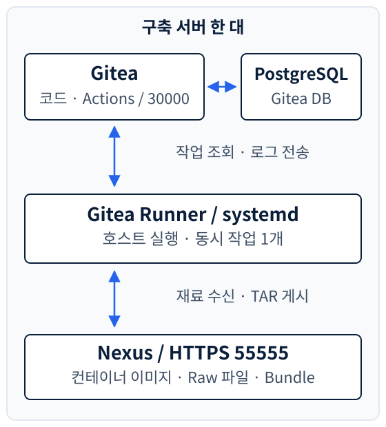

<section class="editorial-summary editorial-summary--text-only" aria-labelledby="editorial-summary-title">
  <div class="editorial-summary-layout">
    <div class="editorial-summary-copy">
      <span class="editorial-summary-label">사내 Gitea 경량화 · 구축 편</span>
      <h2 id="editorial-summary-title" class="editorial-summary-title">코드 서버와 파일 저장소를 띄우고, 그 둘을 사용할 Runner를 연결한다.</h2>
      <p>Gitea·PostgreSQL·Nexus는 컨테이너로 실행하고, 패키징을 수행하는 Runner는 호스트의 systemd 서비스로 실행했다. 설정·작업 디렉터리·설치 재료 캐시를 구분하고, 주소와 비밀값도 서로 다른 위치에서 관리한다.</p>
    </div>
  </div>
  <p class="editorial-summary-result"><span>이번 편의 범위는 <strong>서비스 구축과 Runner 연결 확인까지</strong>다. Ansible 파일 이관과 릴리스 패키징 로직은 다음 편부터 이어간다.</span></p>
</section>

[1편](2026-10-15-gitea-lightweight-1.md)에서는 26GiB clone의 원인과 코드·설치 재료를 분리한 이유를 살펴봤다. 이번에는 그 구조를 실제 서비스로 구성한다.

여기서 구축하는 것은 **사내 자동화 서버**다. 고객사에 이 구성을 그대로 옮기거나 Gitea·Runner를 다시 설치하는 것은 아니다. 고객사의 Private Nexus와 Ansible 준비는 [6편](2026-10-21-gitea-lightweight-6.md)에서 다룬다.

실제 사용 중인 Compose·Runner 설정을 기준으로 정리했다. 예제에서는 주소와 비밀번호 관리를 정리하고, 지원하지 않는 Compose 옵션을 제외했다. 서버에 적용된 값과 다르게 제안하는 부분은 해당 위치에 표시한다.

## 1. 무엇을 어디에 실행하는가

기준 환경은 **Ubuntu 24.04 LTS, x86_64 서버 한 대**다. Gitea와 Nexus를 같은 서버에 두고, 같은 서버의 Runner가 파일 수집과 패키징 명령을 실행한다.

| 구성 요소 | 확인한 버전 | 실행 방식 | 역할 |
| --- | --- | --- | --- |
| Gitea | `1.25.4` | `nerdctl compose` | 코드·태그·Actions 관리 |
| PostgreSQL | `14` 계열 이미지 | Gitea와 같은 Compose | Gitea의 사용자·저장소·작업 메타데이터 |
| Nexus Repository | `3.96.1` | 별도 `nerdctl compose` | 컨테이너 이미지와 일반 파일 보관 |
| Gitea Runner | `4.0.0` | systemd | 호스트에서 Workflow 명령 실행 |
| containerd / nerdctl | `2.2.1` / `2.2.2` | 호스트 런타임·CLI | 서비스 컨테이너와 패키징 이미지 관리 |

Gitea `1.25.4`와 Runner `4.0.0`은 서로 다른 프로그램의 버전이다. Runner 버전과 Gitea 버전을 같은 숫자로 맞추는 구성이 아니다.

[{ .architecture-diagram }](../assets/gitea-lightweight-2/services.svg)

Runner는 Gitea에서 작업을 조회하고 실행 로그와 결과를 돌려준다. 패키징에 필요한 파일과 이미지는 Nexus에서 받고, 완성된 TAR도 Nexus에 올린다.

**Runner만 호스트 실행을 선택한 이유**는 패키징에서 호스트의 nerdctl, 파일 캐시, 작업 경로를 사용하기 때문이다. 이 구성의 `:host` 작업은 Runner 컨테이너 내부가 아니라 실제 서버에서 실행된다. 이번 시리즈는 외부 Action 이미지 없이 셸 명령 중심으로 구성한다. [Runner 실행 방식](https://docs.gitea.com/runner/)

사용할 포트는 다음과 같다. 예제 서버 주소는 `192.0.2.10`으로 통일했다.

| 접속점 | 포트 | 설명 |
| --- | --- | --- |
| Gitea 웹·Git HTTPS | `30000` | `https://192.0.2.10:30000` |
| Gitea Git SSH | `222` | 컨테이너의 SSH 22번으로 전달 |
| Nexus HTTPS | `55555` | 웹 UI·REST API·Docker path-based routing |
| PostgreSQL | 외부 공개 안 함 | Compose 내부에서 `db:5432`로 연결 |
| Runner metrics | `127.0.0.1:9101` | 서버 내부에서만 지표 조회 |

실제 구성의 `8443`은 Nexus 자체 포트가 아니라 **HAProxy의 릴리스 다운로드 진입점**이다. 고정 다운로드 주소를 버전별 TAR로 연결하는 설정은 패키징 편에서 다룬다. 이 단계의 Nexus 접속은 `55555`를 사용한다.

---

## 2. 런타임과 데이터 경로 먼저 준비하기

컨테이너를 지웠다가 다시 만들어도 데이터가 남도록 서비스 데이터를 호스트 디렉터리에 저장한다. Compose 파일과 서비스 데이터는 구분한다.

```text title="서비스 설정과 영구 데이터 경로"
/root/compose/
  ├── .env
  ├── gitea-compose.yaml
  └── nexus-compose.yaml

/data/gitea/
  ├── certs/
  ├── gitea-data/
  └── postgres-data/

/data/nexus/nexus-data/
  ├── etc/
  ├── db/
  └── blobs/

/etc/gitea-runner/config.yaml
/etc/gitea-runner-env/bundle-pipeline.env
/var/lib/gitea-runner/
  ├── .runner
  ├── logs/
  └── workspace/
```

`blobs/`는 Nexus가 파일 본체를 저장하는 내부 영역이다. 파일을 업로드할 때 이 디렉터리에 직접 복사하는 것이 아니라 Repository URL이나 UI를 사용한다.

**이미 런타임이 있다면 교체하지 않는다.** 실제 서버도 기존 containerd·runc·CNI와 nerdctl을 사용했다. CNI는 컨테이너의 네트워크를 만드는 플러그인이다.

```bash title="호스트에서 기존 런타임 확인"
systemctl is-active containerd
nerdctl version
nerdctl compose version
nerdctl info
```

<details class="analysis-toggle" markdown="1">
<summary>런타임이 없는 새 서버라면 — nerdctl Full 패키지로 준비</summary>

아래는 **런타임이 없는 새 Ubuntu 서버용 설치 예시**다. 실행 중인 containerd가 있는 서버에서 덮어쓰는 명령이 아니다. nerdctl Full에는 containerd·runc·CNI 등이 함께 들어 있다. Full 2.2.2의 runc 버전은 실제 서버의 Ubuntu 패키지 버전과 다르다. [nerdctl 2.2.2 배포 구성](https://github.com/containerd/nerdctl/releases/tag/v2.2.2)

root 셸에서 실행한다. 작업용 다운로드 경로는 `/root/downloads/nerdctl`이다.

```bash title="신규 서버의 런타임 설치"
apt-get update
apt-get install -y ca-certificates curl git jq openssl util-linux iptables sudo

install -d /root/downloads/nerdctl
cd /root/downloads/nerdctl
curl -fLO https://github.com/containerd/nerdctl/releases/download/v2.2.2/nerdctl-full-2.2.2-linux-amd64.tar.gz
curl -fLO https://github.com/containerd/nerdctl/releases/download/v2.2.2/SHA256SUMS
grep ' nerdctl-full-2.2.2-linux-amd64.tar.gz$' SHA256SUMS | sha256sum -c -

tar -xzf nerdctl-full-2.2.2-linux-amd64.tar.gz -C /usr/local
systemctl daemon-reload
systemctl enable --now containerd
nerdctl info
```

이 패키지에 BuildKit 바이너리도 포함되지만, 이번 편처럼 배포된 이미지를 pull하여 서비스만 실행하는 데 BuildKit 서비스를 켤 필요는 없다.

</details>

아래 디렉터리 생성은 새 환경에서 root로 수행한다. Gitea 데이터는 컨테이너의 UID/GID `1000:1000`, Nexus 데이터는 `200:200`에 맞춘다. PostgreSQL의 빈 데이터 디렉터리는 이미지가 초기화하도록 둔다.

```bash title="서비스 데이터 경로 준비"
install -d -m 0700 /root/compose
install -d -m 0755 /data/gitea/certs /data/gitea/postgres-data
install -d -m 0755 -o 1000 -g 1000 /data/gitea/gitea-data
install -d -m 0755 -o 200 -g 200 \
  /data/nexus/nexus-data /data/nexus/nexus-data/etc
install -d -m 0700 -o 200 -g 200 /data/nexus/nexus-data/etc/ssl
```

!!! warning "기존 데이터 디렉터리에 재귀 chown을 적용하지 않는다"
    UID 숫자가 호스트의 다른 계정 이름으로 보일 수 있다. 특히 PostgreSQL 이미지의 UID와 Runner UID가 우연히 같아도 역할은 다르다. 기존 DB나 Nexus 데이터의 소유자를 일괄 변경하지 않는다.

---

## 3. Gitea와 PostgreSQL 구성하기

Gitea의 설정은 Compose 환경변수로 관리하고, 최초 설치 이후 생성되는 `app.ini`는 데이터 디렉터리에 보관한다. 같은 항목을 두 곳에서 따로 수정하지 않는다. `GITEA__섹션__키` 형식의 환경변수는 컨테이너 기동 시 설정 파일에 반영된다. [Gitea 1.25 컨테이너 설치](https://docs.gitea.com/1.25/installation/install-with-docker/)

<p class="subsection-title"><strong>3-1. 접속 주소와 DB 비밀번호 준비</strong></p>

<div class="section-body" markdown="1">

실제 Compose에 직접 들어 있던 주소와 DB 비밀번호는 예제에서 `.env`로 분리했다. 아래 명령은 새 파일을 만드는 초기 1회 작업이다. 이미 운영 중인 `.env`를 덮어쓰거나 DB 비밀번호를 재생성하는 용도로 쓰지 않는다.

```bash title="/root/compose/.env 초기 생성"
cd /root/compose
umask 077
printf 'GITEA_HOST=192.0.2.10\nGITEA_DB_PASSWORD=%s\n' \
  "$(openssl rand -hex 32)" > .env
chmod 600 .env
```

`GITEA_HOST`에는 실제 접속할 IP 또는 DNS 이름을 넣는다. `.env`는 Compose 전용이며 Git에 올리지 않는다. 뒤에서 만들 Runner의 `bundle-pipeline.env`와는 다른 파일이다.

DB 데이터가 이미 있다면 `POSTGRES_PASSWORD` 환경변수만 바꿔도 기존 DB 계정 비밀번호가 변경되는 것은 아니다. 최초 초기화와 기존 계정 변경은 구분한다. [PostgreSQL 이미지의 초기화 환경변수](https://hub.docker.com/_/postgres)

</div>

<p class="subsection-title"><strong>3-2. Gitea HTTPS 인증서 준비</strong></p>

<div class="section-body" markdown="1">

실제 환경은 자체 서명 인증서를 사용한다. 아래도 같은 방식이며, SAN에는 실제 접속 주소를 넣는다. SAN은 인증서가 유효한 IP·DNS 이름을 명시하는 항목이다.

```bash title="예제 IP용 Gitea 인증서 생성"
openssl req -x509 -nodes -newkey rsa:3072 -days 365 \
  -keyout /data/gitea/certs/gitea.key \
  -out /data/gitea/certs/gitea.crt \
  -subj '/CN=192.0.2.10' \
  -addext 'subjectAltName=IP:192.0.2.10'

chown 1000:1000 /data/gitea/certs/gitea.key /data/gitea/certs/gitea.crt
chmod 600 /data/gitea/certs/gitea.key
chmod 644 /data/gitea/certs/gitea.crt
```

DNS로 접속한다면 `DNS:이름`도 추가한다. 인증서 생성 명령은 기존 인증서를 덮어쓰므로 새 환경에서만 실행한다. 운영에서는 사내 CA로 발급한 인증서와 신뢰 설정을 사용할 수 있다.

</div>

<details class="analysis-toggle" markdown="1">
<summary>3-3. gitea-compose.yaml 전체 설정</summary>

실제 Gitea·PostgreSQL 버전, 데이터 경로, 포트는 유지했다. 인증서는 읽기 전용으로 마운트하고, Actions 활성화는 명시적으로 지정했다.

```yaml title="/root/compose/gitea-compose.yaml"
services:
  db:
    image: postgres:14
    container_name: gitea-db
    restart: always
    environment:
      POSTGRES_USER: root
      POSTGRES_PASSWORD: ${GITEA_DB_PASSWORD:?set GITEA_DB_PASSWORD}
      POSTGRES_DB: gitea
    volumes:
      - /data/gitea/postgres-data:/var/lib/postgresql/data
    networks:
      - gitea-net

  gitea:
    image: gitea/gitea:1.25.4
    container_name: gitea
    restart: always
    depends_on:
      - db
    environment:
      USER_UID: "1000"
      USER_GID: "1000"
      GITEA__database__DB_TYPE: postgres
      GITEA__database__HOST: db:5432
      GITEA__database__NAME: gitea
      GITEA__database__USER: root
      GITEA__database__PASSWD: ${GITEA_DB_PASSWORD:?set GITEA_DB_PASSWORD}
      GITEA__server__PROTOCOL: https
      GITEA__server__DOMAIN: ${GITEA_HOST:?set GITEA_HOST}
      GITEA__server__ROOT_URL: https://${GITEA_HOST}:30000/
      GITEA__server__HTTP_ADDR: 0.0.0.0
      GITEA__server__HTTP_PORT: "30000"
      GITEA__server__SSH_DOMAIN: ${GITEA_HOST}
      GITEA__server__SSH_PORT: "222"
      GITEA__server__CERT_FILE: /opt/certs/gitea.crt
      GITEA__server__KEY_FILE: /opt/certs/gitea.key
      GITEA__actions__ENABLED: "true"
    volumes:
      - /data/gitea/gitea-data:/data
      - /data/gitea/certs:/opt/certs:ro
    ports:
      - "30000:30000"
      - "222:22"
    networks:
      - gitea-net

networks:
  gitea-net:
    driver: bridge
```

`${GITEA_DB_PASSWORD:?set GITEA_DB_PASSWORD}`는 해당 변수가 미설정이거나 비어 있으면 기동 전에 오류를 내는 문법이다.

`POSTGRES_USER: root`는 실제 구성에서 사용한 PostgreSQL 역할 이름이다. 호스트의 root 로그인과는 별개다. 새 환경에서 이름을 변경한다면 Gitea의 DB 사용자도 맞춰야 한다. 기존 DB에 사용자 이름만 바꿔 적용하지 않는다.

</details>

<p class="subsection-title"><strong>3-4. DB 준비를 확인한 뒤 Gitea 기동</strong></p>

<div class="section-body" markdown="1">

`depends_on`으로 기동 순서를 지정해도 DB의 접속 준비까지 기다리는 것은 아니다. 먼저 DB를 기동하고 준비 상태를 확인한다.

```bash title="Gitea 최초 기동"
cd /root/compose
nerdctl compose -p gitea -f gitea-compose.yaml up -d db
nerdctl exec gitea-db pg_isready -U root -d gitea
```

`accepting connections`가 나오면 Gitea를 기동한다.

```bash title="Gitea 기동과 HTTPS 확인"
nerdctl compose -p gitea -f gitea-compose.yaml up -d gitea
nerdctl logs --tail 50 gitea
curl -kfsS https://192.0.2.10:30000/api/v1/version
```

브라우저에서 Gitea를 열고 최초 설치를 마친 뒤 관리자를 생성한다. DB 호스트는 서버 IP가 아니라 `db:5432`다.

설정 파일은 다음 위치에 남는다.

```text title="app.ini 저장 위치"
호스트:     /data/gitea/gitea-data/gitea/conf/app.ini
컨테이너:   /data/gitea/conf/app.ini
```

`app.ini`에는 생성된 암호화 키와 내부 토큰 등도 포함된다. 공개 자료에 파일 전체를 붙여 넣지 않는다.

</div>

---

## 4. Nexus를 HTTPS로 기동하기

Nexus는 `sonatype/nexus3:3.96.1`을 사용하고 `/nexus-data`를 호스트에 영구 저장한다. 확인한 구성은 **내장 H2 데이터베이스**를 사용하며, Nexus용 PostgreSQL 컨테이너는 없다.

Gitea용 PostgreSQL과 Nexus 내부 DB는 별개다. Nexus를 백업할 때도 Blob만 복사하는 것이 아니라 DB·설정과 일관된 상태로 보관해야 한다.

<p class="subsection-title"><strong>4-1. HTTPS용 키스토어와 설정</strong></p>

<div class="section-body" markdown="1">

Nexus 자체에서 HTTPS를 받도록 구성한다. Java 키스토어는 인증서와 개인키를 담는 파일이다. Gitea처럼 PEM 파일을 그대로 지정하는 설정과는 다르다. [Nexus HTTPS 설정](https://help.sonatype.com/en/configuring-ssl.html)

<details class="analysis-toggle" markdown="1">
<summary>시험용 자체 서명 키스토어 생성</summary>

아래는 최초 구축 예시다. Jetty 기본 설정의 키스토어 암호인 `password`를 사용하므로 시험 환경에 한정한다. 운영에서 바꿀 때는 키스토어 암호와 Jetty의 키스토어·키 관리자·신뢰 저장소 암호 설정을 맞춘다.

호스트에 Java를 추가하지 않고 Nexus 이미지에 있는 `keytool`만 일시적인 컨테이너에서 실행한다.

```bash title="Nexus 기동 전 인증서 생성"
nerdctl pull sonatype/nexus3:3.96.1
nerdctl run --rm --user 0 --entrypoint keytool \
  -v /data/nexus/nexus-data:/nexus-data \
  sonatype/nexus3:3.96.1 \
  -genkeypair -alias nexus -keyalg RSA -keysize 3072 \
  -storetype JKS -validity 365 \
  -keystore /nexus-data/etc/ssl/keystore.jks \
  -storepass password -keypass password \
  -dname 'CN=192.0.2.10' \
  -ext 'SAN=IP:192.0.2.10,DNS:nexus'

chown 200:200 /data/nexus/nexus-data/etc/ssl/keystore.jks
chmod 600 /data/nexus/nexus-data/etc/ssl/keystore.jks
```

기존 키스토어에 재생성하지 않는다. DNS 이름으로 접속할 때는 그 이름도 SAN에 넣는다.

</details>

다음 내용을 새 파일로 저장한다. `jetty-http.xml`을 포함하지 않으므로 Nexus의 평문 HTTP 커넥터는 기동하지 않는다.

```properties title="/data/nexus/nexus-data/etc/nexus.properties"
application-host=0.0.0.0
application-port-ssl=55555
nexus-args=${jetty.etc}/jetty.xml,${jetty.etc}/jetty-https.xml,${jetty.etc}/jetty-requestlog.xml
ssl.etc=${karaf.data}/etc/ssl
nexus-context-path=/
```

`nexus.properties`는 UID 200인 Nexus 프로세스가 읽을 수 있어야 한다.

```bash title="Nexus 설정 파일 권한"
chown 200:200 /data/nexus/nexus-data/etc/nexus.properties
chmod 640 /data/nexus/nexus-data/etc/nexus.properties
```

</div>

<details class="analysis-toggle" markdown="1">
<summary>4-2. nexus-compose.yaml 전체 설정</summary>

JVM 설정·데이터 경로·포트는 실제 구성을 사용한다. heap과 direct memory는 별도 영역이므로 `-Xmx2703m`을 컨테이너 전체의 필요 메모리로 해석하지 않는다. 같은 서버의 Gitea·DB·Runner 작업에 필요한 메모리도 확보한다. [Nexus 공식 컨테이너 설정](https://github.com/sonatype/docker-nexus3)

```yaml title="/root/compose/nexus-compose.yaml"
services:
  nexus:
    image: sonatype/nexus3:3.96.1
    container_name: nexus
    hostname: nexus
    restart: unless-stopped
    ports:
      - "55555:55555"
    environment:
      INSTALL4J_ADD_VM_PARAMS: >-
        -Xms2703m
        -Xmx2703m
        -XX:MaxDirectMemorySize=2703m
        -Djava.util.prefs.userRoot=/nexus-data/javaprefs
        -Duser.timezone=Asia/Seoul
    volumes:
      - /data/nexus/nexus-data:/nexus-data
    ulimits:
      nofile:
        soft: 65536
        hard: 65536
    logging:
      driver: json-file
      options:
        max-size: "20m"
        max-file: "5"
    networks:
      - nexus-net

networks:
  nexus-net:
    driver: bridge
```

**실제 파일에서 제외한 항목은 `healthcheck`와 `stop_grace_period`다.** nerdctl 2.2.2의 Compose에서는 두 필드가 미구현 상태다. 적어 놓는 것만으로 상태 점검과 종료 대기가 적용되지는 않는다. [2.2.2 Compose 지원 항목](https://github.com/containerd/nerdctl/blob/v2.2.2/docs/compose.md)

준비 상태는 아래의 `curl`로 확인한다. Nexus를 종료할 때는 DB 종료를 기다릴 수 있도록 명시적으로 유예 시간을 준다.

```bash title="Nexus를 의도적으로 중지할 때만 실행"
nerdctl stop -t 120 nexus
```

이는 조회 명령이 아니라 서비스를 중지하는 작업이다. 일반적인 구축 확인에서는 실행하지 않는다.

</details>

<p class="subsection-title"><strong>4-3. 기동과 초기 설정</strong></p>

<div class="section-body" markdown="1">

```bash title="Nexus 기동과 준비 상태 확인"
cd /root/compose
nerdctl compose -p nexus -f nexus-compose.yaml up -d
nerdctl logs --tail 50 nexus
curl -kfsS https://192.0.2.10:55555/service/rest/v1/status
```

HTTP 200이 나오면 브라우저에서 `https://192.0.2.10:55555`를 연다. 처음에는 DB 초기화가 있어 컨테이너가 Up이더라도 HTTPS 응답 준비 전일 수 있다.

초기 사용자는 `admin`이며 초기 비밀번호는 `/data/nexus/nexus-data/admin.password`에 생성된다. 관리용 터미널에서만 확인하고 최초 로그인 시 변경한다. 초기 설정의 EULA는 이용 약관 동의이며, Repository 접근 권한과는 별개다.

로그인한 사용자만 접근하게 하려면 익명 접근을 비활성화한다. 배포와 CI에는 뒤에서 설명할 전용 계정을 사용한다.

</div>

---

## 5. Blob Store와 Repository 구분하기

Blob Store는 파일 본체의 저장 영역이고, Repository는 파일 형식과 접근 경로를 정의하는 논리적인 입구다. Blob Store가 같아도 Docker와 Raw는 별도 Repository로 나눈다.

사용할 Blob Store 이름은 `contrabass-engine`이다. 기본 제공되는 `default`를 삭제할 필요는 없다.

```text title="역할별 Repository 구성"
Blob Store: contrabass-engine
  ├── docker-hosted        # 컨테이너 이미지
  ├── raw-hosted           # 압축 파일·바이너리·QCOW2 등
  ├── raw-manifest         # 릴리스 파일 목록·식별 정보
  ├── raw-release-bundle   # 최종 반입용 TAR
  └── raw-release-staging  # 검증 전 후보 TAR. 후속 검증 편에서 사용
```

생성 위치는 Nexus 관리 화면의 **Administration → Repository → Blob Stores**와 **Repositories**다.

| 생성 순서 | 설정 | 값 |
| --- | --- | --- |
| 1 | Blob Stores → Create blob store | File 형식, 이름 `contrabass-engine` |
| 2 | Repositories → Create repository | `docker (hosted)`로 `docker-hosted` 생성 |
| 3 | Repositories → Create repository | `raw (hosted)`로 각 Raw Repository 생성 |
| 공통 | Storage의 Blob store | `contrabass-engine` 선택 |

`raw-release-staging`은 후속 시험용이다. Gitea·Nexus·Runner 연결만 확인하는 단계에서 후보 TAR 업로드까지 구성할 필요는 없다.

**Docker는 Path-based routing을 선택한다.** 이 구성은 Repository마다 8082·8083 같은 포트를 추가하지 않는다. Nexus 3.96.1에서는 Repository 이름을 이미지 이름 앞에 넣어 같은 HTTPS 포트로 접근할 수 있다. [Nexus Docker 라우팅](https://help.sonatype.com/en/docker-registry.html)

```text title="Raw와 컨테이너 이미지 주소의 차이"
Raw:
https://192.0.2.10:55555/repository/raw-hosted/ansible-runtime/파일명

Container image:
192.0.2.10:55555/docker-hosted/ansible/openstack-ansible:v1.6
```

컨테이너 이미지 이름에는 `https://`와 `/repository/`를 붙이지 않는다. Raw URL과 표기법이 다르다.

Docker 클라이언트 인증을 위해 **Administration → Security → Realms**에서 `Docker Bearer Token Realm`도 활성화한다. Raw의 HTTP 인증과는 별도 설정이다.

쓰기 정책은 Repository별로 구분한다.

| Repository | 정책 |
| --- | --- |
| `raw-hosted` | 버전별 경로로 저장하고 원칙적으로 재업로드 금지 |
| `raw-manifest` | 릴리스별 정보는 불변. 채널 정보는 갱신하므로 Repository에서는 재업로드 허용 |
| `raw-release-bundle` | 버전별 TAR는 불변. 채널 정보는 갱신하므로 Repository에서는 재업로드 허용 |
| `raw-release-staging` | 후보별 경로에 저장하고 시험 후 삭제 |

불변은 같은 릴리스 이름으로 내용을 바꾸지 않는다는 뜻이다. Repository에서 덮어쓰기를 허용하더라도 릴리스 경로의 불변성은 후속 공개 스크립트에서 확인한다.

---

## 6. Runner를 systemd 서비스로 등록하기

Runner 실행 계정은 `gitea-runner`, 홈은 `/var/lib/gitea-runner`다. 로그인 셸은 `nologin`으로 둔다. systemd나 `sudo -u`로 실행하는 프로세스에는 대화형 로그인 셸이 필요하지 않다.

<p class="subsection-title"><strong>6-1. 사용자와 바이너리</strong></p>

<div class="section-body" markdown="1">

아래는 최초 등록용이다. 이미 등록된 Runner를 다시 만드는 명령이 아니다.

```bash title="전용 사용자와 작업 영역"
useradd --system --user-group \
  --home-dir /var/lib/gitea-runner --create-home \
  --shell /usr/sbin/nologin gitea-runner

install -d -m 0750 -o root -g gitea-runner /etc/gitea-runner
install -d -m 0750 -o root -g gitea-runner /etc/gitea-runner-env
install -d -m 0750 -o gitea-runner -g gitea-runner \
  /var/lib/gitea-runner/logs /var/lib/gitea-runner/workspace
```

Runner 4.0.0의 바이너리와 체크섬을 같은 공식 배포처에서 받는다.

```bash title="Runner 4.0.0 설치"
install -d /root/downloads/gitea-runner
cd /root/downloads/gitea-runner
curl -fLO https://dl.gitea.com/gitea-runner/4.0.0/gitea-runner-4.0.0-linux-amd64
curl -fLO https://dl.gitea.com/gitea-runner/4.0.0/gitea-runner-4.0.0-linux-amd64.sha256
sha256sum -c gitea-runner-4.0.0-linux-amd64.sha256
install -m 0755 gitea-runner-4.0.0-linux-amd64 /usr/local/bin/gitea-runner
gitea-runner --version
```

4.0.0에서는 `config generate`로 설정 예시를 확인할 수 있다. 아래 문서 예제는 실제 설정 중 필요한 항목을 추렸다. [Runner 4.0.0 릴리스](https://blog.gitea.com/release-of-runner-4.0.0/)

```bash title="설치한 버전의 설정 항목 확인"
gitea-runner config generate
```

</div>

<details class="analysis-toggle" markdown="1">
<summary>6-2. Runner 설정 — host 라벨·동시 실행 1개·저장 경로</summary>

```yaml title="/etc/gitea-runner/config.yaml"
log:
  level: info
  job:
    dir: /var/lib/gitea-runner/logs
    retention: 168h
    max_size: 20MB

runner:
  file: /var/lib/gitea-runner/.runner
  capacity: 1
  timeout: 3h
  shutdown_timeout: 3h
  insecure: true
  labels:
    - "contrabass-engine-release:host"
  workdir_cleanup_age: 24h
  idle_cleanup_interval: 10m

cache:
  enabled: false

host:
  workdir_parent: /var/lib/gitea-runner/workspace

health_check:
  enabled: true
  min_free_disk_space_mb: 20480
  interval: 30s
  timeout: 10s

metrics:
  enabled: true
  addr: 127.0.0.1:9101
  readiness_grace: 30s
```

주요 설정의 의미는 다음과 같다.

| 설정 | 의미 |
| --- | --- |
| `contrabass-engine-release:host` | 해당 이름의 작업을 호스트에서 실행 |
| `capacity: 1` | 동시에 실행하는 작업 1개 |
| `timeout: 3h` | 작업 전체의 실행 제한 시간 |
| `shutdown_timeout: 3h` | Runner 종료 시 진행 중인 작업을 기다리는 상한 |
| `workdir_parent` | Workflow 작업 디렉터리의 상위 경로 |
| `insecure: true` | Gitea 접속 시 TLS 인증서 검증 생략 |
| `min_free_disk_space_mb` | workspace 파일시스템의 공간 부족 시 새 작업 수신 억제 |

`insecure`는 Gitea 접속용이다. `curl`·Git·Nexus 접근의 검증까지 한꺼번에 생략하는 설정이 아니다. 자체 서명 시험에서는 클라이언트별 설정을 구분하고, 운영에서는 CA를 신뢰하도록 구성한다.

`cache.enabled: false`는 Actions 캐시 서비스를 사용하지 않는 설정이다. 후속 편에서 구성할 Raw SHA256 캐시와 containerd 이미지 재사용은 별개이므로 비활성화되지 않는다.

실제 설정의 `action_shallow_clone: true`는 예제에서 생략했다. 외부 Action 저장소를 받을 때 쓰는 설정이며, 셸 안의 `git clone`을 자동으로 shallow clone으로 바꾸지는 않는다. 후속 소스 다운로드 명령에는 직접 `--depth=1`을 지정한다.

</details>

<p class="subsection-title"><strong>6-3. Gitea에 등록</strong></p>

<div class="section-body" markdown="1">

Gitea 대상 Repository에서 **Settings → Actions → Runners**를 열고 등록 토큰을 발급한다. 해당 Repository에서만 사용할 Runner라면 이 범위에서 등록한다. 관리 화면이나 조직에서 발급한 토큰은 등록 범위가 다르다. [Runner 등록](https://docs.gitea.com/runner/registration/)

`config.yaml`을 저장한 뒤 Runner 계정으로 대화형 등록을 진행한다. 등록 토큰은 명령 인자나 Workflow 파일에 적지 않고 등록 프롬프트에서 입력한다.

```bash title="Runner 계정으로 대화형 등록"
chown root:gitea-runner /etc/gitea-runner/config.yaml
chmod 640 /etc/gitea-runner/config.yaml
cd /var/lib/gitea-runner
sudo -u gitea-runner /usr/local/bin/gitea-runner \
  --config /etc/gitea-runner/config.yaml register
```

입력값은 다음과 같다.

| 항목 | 예시 |
| --- | --- |
| Gitea instance | `https://192.0.2.10:30000/` |
| Runner token | 화면에서 발급한 등록 토큰 |
| Runner name | `release-runner` |
| Labels | `contrabass-engine-release:host` |

등록 결과는 `/var/lib/gitea-runner/.runner`에 저장된다. 인증 정보를 포함하므로 공개하거나 Git에 넣지 않는다.

```bash title="등록 파일은 Runner 계정만 읽도록 설정"
chown gitea-runner:gitea-runner /var/lib/gitea-runner/.runner
chmod 600 /var/lib/gitea-runner/.runner
```

등록 토큰은 Git clone용 개인 액세스 토큰이나 Nexus 비밀번호가 아니다. 각각 용도가 다르다.

</div>

<details class="analysis-toggle" markdown="1">
<summary>6-4. systemd 서비스 전체 설정</summary>

실제 서비스의 전용 계정·기동 명령·작업 경로를 유지했다. 문서 예제에는 containerd 이후 기동 순서를 추가하고, `TimeoutStopSec`를 기존 2시간 대신 **3시간 5분**으로 정리했다. Runner의 종료 대기 3시간보다 systemd가 먼저 강제 종료하지 않도록 여유를 둔 값이다.

```ini title="/etc/systemd/system/gitea-runner.service"
[Unit]
Description=Gitea Actions Runner 4.0.0
Wants=network-online.target containerd.service
After=network-online.target containerd.service

[Service]
Type=simple
User=gitea-runner
Group=gitea-runner
WorkingDirectory=/var/lib/gitea-runner
Environment="HOME=/var/lib/gitea-runner"
Environment="PATH=/usr/local/sbin:/usr/local/bin:/usr/sbin:/usr/bin:/sbin:/bin"
ExecStart=/usr/local/bin/gitea-runner daemon --config /etc/gitea-runner/config.yaml
Restart=on-failure
RestartSec=5s
TimeoutStopSec=3h 5min
KillSignal=SIGTERM
LimitNOFILE=65536
UMask=0022
StandardOutput=journal
StandardError=journal

[Install]
WantedBy=multi-user.target
```

기동 전 unit 문법을 확인한다. 아래는 새 서비스를 기동하는 절차다.

```bash title="Runner 서비스 최초 기동"
systemd-analyze verify /etc/systemd/system/gitea-runner.service
systemctl daemon-reload
systemctl enable --now gitea-runner
systemctl is-active gitea-runner
journalctl -u gitea-runner -n 30 --no-pager
```

Gitea의 Runners 화면에서도 Online 상태와 라벨을 확인한다. `WorkingDirectory`는 Runner 자체의 기준 디렉터리이며, 개별 작업은 `host.workdir_parent` 아래 작업 영역에서 수행된다.

작업 제한 시간은 Runner뿐 아니라 Gitea와 Workflow에도 있다. 긴 Ansible 시험을 붙일 때는 다른 곳에 짧은 상한이 남아 있지 않은지 함께 확인한다.

</details>

---

## 7. 주소·비밀값·실행 권한 분리하기

역할에 맞게 설정 위치를 나누면 나중에 스크립트마다 같은 주소와 경로를 다시 적지 않아도 된다.

| 저장 위치 | 관리할 내용 |
| --- | --- |
| `/root/compose/.env` | Compose 주소·DB 비밀번호. root만 읽음 |
| `/etc/gitea-runner/config.yaml` | Runner 동작·라벨·로그·workspace |
| `/etc/gitea-runner-env/bundle-pipeline.env` | 파이프라인 주소·Repository 이름·작업 경로 |
| Gitea Actions Secrets | Git 읽기 토큰·Nexus 게시용 비밀번호 |
| `/var/lib/gitea-runner/.runner` | Runner 등록 정보. 다른 인증 용도로 재사용하지 않음 |

설정 파일을 만든다고 **자동으로 Workflow에 전달되지는 않는다.** 필요한 스텝에서 `source`한다. 이번 연결 확인 단계에 필요한 최소 설정은 다음 한 줄이다.

```bash title="/etc/gitea-runner-env/bundle-pipeline.env — 연결 확인 단계"
NEXUS_URL=https://192.0.2.10:55555
```

후속 패키징 단계에서는 `BUNDLE_BUILDER_DIR`·`BUNDLE_WORK_DIR`·`RAW_CACHE_DIR` 등을 같은 파일에 추가한다. 아직 도입하지 않은 빌더 스크립트나 Nexus 이미지 TAR까지 이 단계에서 준비할 필요는 없다.

```bash title="공통 설정은 Runner가 읽을 수 있도록 지정"
chown root:gitea-runner /etc/gitea-runner-env/bundle-pipeline.env
chmod 640 /etc/gitea-runner-env/bundle-pipeline.env
```

Git 읽기용 `REPO_READ_TOKEN`과 Nexus 게시용 `NEXUS_RUNNER_PASSWORD`는 Gitea의 **Repository Settings → Actions → Secrets**에 등록한다. 코드에서는 `${{ secrets.REPO_READ_TOKEN }}`처럼 참조한다. Nexus 비밀번호를 Runner 등록 토큰 대신 사용하는 것은 아니다.

Nexus 사용자도 다운로드용과 게시용을 분리한다.

| 용도 | 권한 방향 |
| --- | --- |
| 다운로드 | 필요한 Repository의 `browse`·`read` |
| CI 게시 | 필요한 Repository의 `browse`·`read`·`add`·`edit` |
| 오래된 Bundle·후보 정리 | 정리 대상 Repository에만 `delete` 추가 |

실제 패키징에서는 REST API 검색과 삭제도 사용한다. 게시 계정은 담당 Repository의 조회·업로드·채널 갱신·보관 정리에 필요한 권한으로 제한한다. 시험 저장소를 추가할 때의 계정 구분은 [5편](../automation/2026-10-21-gitea-lightweight-5.md)에서 이어간다.

!!! warning "호스트 실행 Runner의 명령은 호스트 권한을 사용한다"
    실제 구성에서는 일반 Runner 계정이 root 소유 containerd 소켓을 직접 쓰지 않고, 필요한 빌드 작업을 root 소유 전용 래퍼로 호출한다. 소켓을 777로 바꾸거나 Runner에 무제한 sudo를 주지 않는다. 래퍼의 역할과 호출 관계는 4편에서 설명한다.

---

## 8. 작은 Workflow로 연결부터 확인하기

처음부터 수 GiB Bundle을 만들지 않고 **Runner가 작업을 받아 Gitea와 Nexus에 접근할 수 있는지** 확인한다.

Gitea 대상 Repository에서 Actions를 활성화하고, 다음 Workflow를 기본 브랜치에 commit·push한다. 기존 게시 Workflow에 추가하는 작업이 아니라 최초 연결 확인용 예제다. 확인 뒤 필요하지 않으면 이 Workflow는 제거한다.

```yaml title=".gitea/workflows/check-services.yaml"
name: Check release services

"on":
  workflow_dispatch:

jobs:
  check:
    runs-on: contrabass-engine-release
    steps:
      - name: Check host tools and HTTPS endpoints
        shell: bash
        run: |
          set -euo pipefail
          source /etc/gitea-runner-env/bundle-pipeline.env
          id
          pwd
          for tool in bash git curl tar sha256sum jq flock nerdctl; do
            command -v "${tool}"
          done
          curl -kfsS "${GITHUB_SERVER_URL%/}/api/v1/version"
          curl -kfsS "${NEXUS_URL%/}/service/rest/v1/status"
```

Gitea Actions 화면에서 수동 실행한다. 작업의 `runs-on`에는 등록 라벨 이름만 적는다. `:host`는 Runner 쪽에 지정하는 실행 방식이다.

`GITHUB_SERVER_URL`은 이름과 달리 이 작업에서는 **Gitea가 전달하는 Gitea 서버 주소**다. GitHub로 접속하는 코드가 아니다. 별도의 주소 변수를 Workflow에 중복 선언하지 않고 기본 환경변수를 사용했다. [Gitea Actions 기본 환경변수](https://docs.gitea.com/usage/actions/actions-variables/)

```text title="일치시킬 라벨"
Runner:   contrabass-engine-release:host
Workflow: runs-on: contrabass-engine-release
```

로그의 `id`가 Runner 계정이고 `pwd`가 workspace 아래이며, 두 HTTPS 확인이 성공하면 이 단계의 연결 확인은 끝난다. `command -v nerdctl`은 바이너리 존재 확인이지, 일반 계정으로 root의 containerd를 조작할 수 있다는 뜻이 아니다.

**확인 대상은 단계별로 구분한다.**

| 확인 | 알 수 있는 것 |
| --- | --- |
| `nerdctl ps` | 서비스 컨테이너 기동 상태 |
| `pg_isready` | Gitea용 DB의 접속 준비 |
| HTTPS `curl` | 지정한 포트의 응답 |
| Runner Online·라벨 | Gitea 등록·연결 상태 |
| 이번 Workflow 성공 | 작업 수신·호스트 실행·기본 통신 |
| 후속 upload·pull 시험 | Repository 권한과 컨테이너 인증 |

이번 연결 확인만으로 Repository 쓰기와 이미지 pull까지 검증한 것은 아니다.

여기까지 구성하면 코드를 보관하는 Gitea, 설치 재료를 공급하는 Nexus, 명령을 실행하는 Runner의 기반이 갖춰진다.

다음 [3편 — 대용량 파일을 Nexus로 옮기고 Ansible 연결하기](2026-10-15-gitea-lightweight-3.md)에서는 설치 재료를 이관하고 Ansible을 연결한다.

[← 1편: 문제와 개선 방향](2026-10-15-gitea-lightweight-1.md) · [3편: Nexus 이관과 Ansible 연결 →](2026-10-15-gitea-lightweight-3.md)
