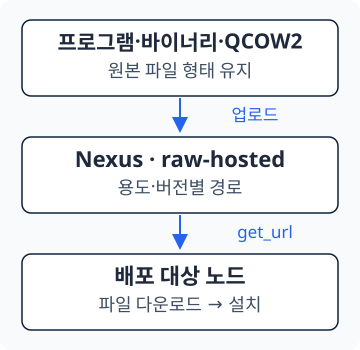
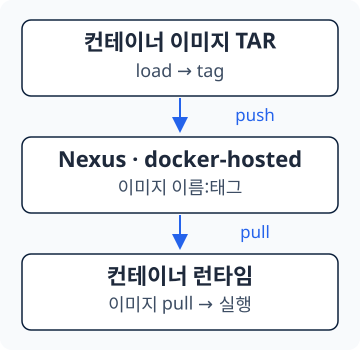

<section class="editorial-summary editorial-summary--text-only" aria-labelledby="editorial-summary-title">
  <div class="editorial-summary-layout">
    <div class="editorial-summary-copy">
      <span class="editorial-summary-label">사내 Gitea 경량화 · Ansible 연결 편</span>
      <h2 id="editorial-summary-title" class="editorial-summary-title">코드는 Git에서, 설치할 파일과 이미지는 Nexus에서 받는다.</h2>
      <p>Git의 대용량 파일을 Nexus로 옮기고, Ansible이 대상 노드에서 필요한 파일을 다운로드하도록 바꿨다. 기존 배포 설정과 서비스 실행 방식은 유지하면서 설치 재료를 가져오는 경로를 분리했다.</p>
    </div>
  </div>
  <p class="editorial-summary-result"><span><strong>Nexus 구조 → Ansible 변경점 → Ansible 받는 방법</strong> 순서로 정리한다.</span></p>
</section>

[2편](2026-10-15-gitea-lightweight-2.md)에서는 Gitea·Nexus·Runner를 구성했다. 이번에는 Git에 있던 파일을 어디로 옮겼는지, 그 파일을 사용하던 Ansible은 어떻게 달라졌는지 살펴본다.

## 1. Nexus 구조

파일 본체를 저장하는 **Blob Store**는 `contrabass-engine` 하나를 사용한다. 그 아래 Repository는 컨테이너 이미지용 `docker-hosted`와 일반 파일용 `raw-hosted`로 나눈다. 아래는 설치 재료를 보관하는 영역의 대표 경로다.

```text title="Nexus의 설치 재료 보관 구조"
Nexus
└── contrabass-engine                  # Blob Store
    ├── docker-hosted                  # 컨테이너 이미지
    │   ├── ansible/
    │   │   └── openstack-ansible:v1.6
    │   └── ceph19.2.3/
    │       ├── ceph:v19.2.3
    │       ├── nvmeof:1.2.5
    │       └── ...
    └── raw-hosted                     # 일반 파일
        ├── ansible-runtime/
        │   ├── containerd-2.1.5-linux-amd64.tar.gz
        │   ├── nerdctl-2.1.6-linux-amd64.tar.gz
        │   ├── buildkit-v0.12.4.linux-amd64.tar.gz
        │   ├── cni-plugins-linux-amd64-v1.8.0.tgz
        │   └── runc.amd64
        ├── contrabass-mole/3.0.6/contrabass-mole.tar.gz
        ├── monitoring/node-exporter/1.6.1/node_exporter-linux-amd64
        ├── storage/seaweedfs/4.0.5/weed-linux-amd64
        ├── openstack/cinder/24.5.0/cinder-24.5.0.tar.gz
        ├── vm-image/cirros-0.6.2-x86_64-disk.img
        └── python-wheel/...
```

| 보관 위치 | 넣는 것 | 가져오는 방식 |
| --- | --- | --- |
| `docker-hosted` | Ansible·Ceph 등 컨테이너 이미지 | 런타임이 이미지 pull |
| `raw-hosted` | 프로그램 압축 파일·바이너리·QCOW2·wheel | URL로 파일 다운로드 |
| Git | Ansible 코드·설정 템플릿·작은 설치 스크립트 | Git clone |

`ceph19.2.3/`에는 cephadm 배포에 쓰는 컨테이너들을 함께 둔다. Grafana·Prometheus 이미지도 이곳에 포함되며, 호스트에 설치하는 `monitoring/`의 바이너리와는 별개다.

<div class="environment-grid" markdown="1">

<div markdown="1">

**일반 파일**

[{ .architecture-diagram }](../assets/gitea-lightweight-3/raw-flow.svg)

</div>

<div markdown="1">

**컨테이너 이미지**

[{ .architecture-diagram }](../assets/gitea-lightweight-3/image-flow.svg)

</div>

</div>

**같은 TAR라도 처리 방식은 다르다.** 일반 압축 파일은 그대로 업로드하지만, 컨테이너를 저장한 TAR는 이미지로 불러온 뒤 tag·push한다. Blob Store 이름은 URL에 넣지 않는다.

<details class="analysis-toggle" markdown="1">
<summary>일반 파일을 올리는 명령</summary>

파일이 있는 작업용 서버에서 실행한다. `release-upload`는 업로드 계정의 예시이며 비밀번호는 프롬프트에서 입력한다. 같은 버전의 내용을 덮어쓰기보다 새 버전 경로를 만든다.

```bash title="Raw 파일 업로드 예시"
NEXUS_URL=https://192.0.2.10:55555
ARTIFACT_PATH=contrabass-mole/3.0.6/contrabass-mole.tar.gz

sha256sum contrabass-mole.tar.gz
curl -kfsS --user release-upload \
  --upload-file contrabass-mole.tar.gz \
  "${NEXUS_URL}/repository/raw-hosted/${ARTIFACT_PATH}"
```

`--upload-file`로 HTTP PUT 요청을 보내며, `/repository/raw-hosted/` 뒤가 보관 경로다. [Nexus Raw Repository](https://help.sonatype.com/en/raw-repositories.html)

</details>

<details class="analysis-toggle" markdown="1">
<summary>컨테이너 이미지를 올리는 명령</summary>

기존 TAR가 있는 작업용 서버에서 실행한다. `load` 출력에서 이미지 이름을 확인한 뒤 tag한다.

```bash title="이미지 load → tag → push"
REGISTRY=192.0.2.10:55555

nerdctl load -i openstack-ansible.tar
nerdctl images
nerdctl tag openstack-ansible:v1.6 \
  "${REGISTRY}/docker-hosted/ansible/openstack-ansible:v1.6"
nerdctl --insecure-registry login --username release-upload "${REGISTRY}"
nerdctl --insecure-registry push \
  "${REGISTRY}/docker-hosted/ansible/openstack-ansible:v1.6"
```

이 구성은 Nexus의 path-based routing을 사용한다. 이미지 주소에는 `/docker-hosted/`가 들어가지만 `/repository/`나 `https://`는 넣지 않는다. [Nexus Docker Registry](https://help.sonatype.com/en/docker-registry.html)

</details>

예제의 `-k`와 `--insecure-registry`는 자체 서명 인증서를 사용하는 시험 환경의 옵션이다. 인증서 검증 생략과 계정 인증 생략은 서로 다르다. 신뢰할 CA가 준비된 환경에서는 인증서 검증을 유지한다. [nerdctl Registry 설정](https://github.com/containerd/nerdctl/blob/v2.2.2/docs/registry.md)

---

## 2. Ansible 변경점

기존에는 `files/`에 있는 바이너리를 `copy`로 전달했다. 변경 후에는 **대상 노드가 Nexus에서 직접 다운로드**한다. 파일의 목적지·권한·서비스 실행 방식은 유지한다.

<p class="subsection-title"><strong>2-1. Nexus 주소와 파일 경로 분리</strong></p>

<div class="section-body" markdown="1">

경로 기준은 `contrabass-engine/okestro/okestro-openstack/`이다.

```text title="Ansible 변수 파일"
inventory/
├── inventory.ini
└── group_vars/all/
    ├── main.yml                       # 환경별 Nexus 주소
    └── nexus.yml                      # 파일별 URL·이미지 주소
```

`main.yml`의 `package_ip` 위에 Nexus 주소를 입력한다. **`https://` 없이 `IP:PORT`만 적는다.** `package_ip`는 별도의 OS 패키지 저장소 설정이다.

```yaml title="inventory/group_vars/all/main.yml — 일부"
# Controller01 API Network
nexus_url: 192.0.2.101:55555
package_ip: 198.51.100.10/rocky-9.6
```

`nexus.yml`이 이 주소에 Repository와 파일 경로를 붙인다. 아래는 대표 항목만 추린 것이다.

<div class="language-yaml highlight"><span class="filename">inventory/group_vars/all/nexus.yml — 일부</span><pre><code>nexus_validate_certs: false
nexus_raw_repository: "raw-hosted"
nexus_docker_repository: "docker-hosted"

nexus_raw_url: "https://&#123;&#123; nexus_url &#125;&#125;/repository/&#123;&#123; nexus_raw_repository &#125;&#125;"
nexus_registry: "&#123;&#123; nexus_url &#125;&#125;"
nexus_docker_url: "&#123;&#123; nexus_registry &#125;&#125;/&#123;&#123; nexus_docker_repository &#125;&#125;"

nexus_images:
  ceph: "&#123;&#123; nexus_docker_url &#125;&#125;/ceph19.2.3/ceph:v19.2.3"

nexus_artifacts:
  contrabass_mole: "&#123;&#123; nexus_raw_url &#125;&#125;/contrabass-mole/3.0.6/contrabass-mole.tar.gz"
  node_exporter: "&#123;&#123; nexus_raw_url &#125;&#125;/monitoring/node-exporter/1.6.1/node_exporter-linux-amd64"
</code></pre></div>

<code>&#123;&#123; 변수명 &#125;&#125;</code>은 변수 값을 끼워 넣는 문법이다. `-i inventory/inventory.ini`로 실행하면 Ansible이 인벤토리 옆의 `group_vars/all/`을 읽는다. 컨테이너에 `NEXUS_URL` 환경변수를 따로 전달할 필요는 없다. [Ansible 인벤토리 변수](https://docs.ansible.com/projects/ansible/latest/inventory_guide/intro_inventory.html)

</div>

<p class="subsection-title"><strong>2-2. 바이너리 전달을 copy에서 get_url로 변경</strong></p>

<div class="section-body" markdown="1">

`roles/prometheus/tasks/node-exporter-install.yml`의 다운로드 task다.

<div class="language-yaml highlight"><span class="filename">Node Exporter 다운로드</span><pre><code>- name: Download Node-exporter binary from Nexus
  ansible.builtin.get_url:
    url: "&#123;&#123; nexus_artifacts.node_exporter &#125;&#125;"
    dest: "&#123;&#123; exe_path &#125;&#125;/node_exporter"
    validate_certs: "&#123;&#123; nexus_validate_certs &#125;&#125;"
    owner: root
    group: root
    mode: '0755'
</code></pre></div>

목적지와 실행 권한은 그대로다. 서비스 설정 템플릿도 Git에 남아 기존 방식으로 배치된다. `get_url`은 기본적으로 대상 노드에서 실행되므로, 각 노드가 Nexus에 접근할 수 있어야 한다. [Ansible get_url](https://docs.ansible.com/projects/ansible/latest/collections/ansible/builtin/get_url_module.html)

다른 파일도 같은 기준으로 바꿨다.

| 대상 | 변경한 부분 | 유지한 부분 |
| --- | --- | --- |
| Contrabass Mole | 압축 파일을 Raw에서 다운로드 | 작은 설치 스크립트 복사·기존 설치 조건 |
| 모니터링 바이너리 | `get_url`로 다운로드 | 실행 경로·권한·서비스 설정 |
| Ceph 컨테이너 | cephadm의 이미지 주소를 Nexus로 연결 | 기존 배포 역할·순서 |

Mole는 기존 목적지 파일이 있으면 다운로드를 건너뛰는 조건이 남아 있다. URL을 바꾸는 것만으로 기존 설치 노드가 자동 업그레이드되지는 않는다. Ceph는 파일 다운로드 대신 Podman이 Nexus Registry에서 이미지를 받는다.

</div>

<p class="subsection-title"><strong>2-3. 파일 버전을 바꿀 때 수정할 곳</strong></p>

<div class="section-body" markdown="1">

패키징 목록과 Ansible의 다운로드 경로를 함께 맞춘다.

| 파일 | 역할 | 수정할 값 |
| --- | --- | --- |
| `release/manifest.yaml` | 패키징에 넣을 재료 목록 | 파일 경로·SHA256, 이미지 태그·digest |
| `inventory/group_vars/all/nexus.yml` | Ansible이 사용할 주소 목록 | 해당 파일 경로·이미지 태그 |
| `inventory/group_vars/all/main.yml` | 환경별 설정 | Nexus 접속 주소 |

SHA256은 파일 내용이 같은지 비교하는 해시이고, digest는 이미지 내용을 식별하는 값이다. 현재는 Ansible이 manifest를 직접 읽는 구조가 아니므로 **파일 버전 변경 시 manifest와 nexus.yml을 함께 수정**한다.

작업 순서는 **새 버전 업로드 → manifest 수정 → nexus.yml 수정 → 코드와 함께 반영**이다. 배포 환경의 Nexus 주소가 같다면 `main.yml`은 바꿀 필요가 없다.

</div>

---

## 3. Ansible 받는 방법

이 절은 **사내에서 릴리스 코드를 받아 확인하는 흐름**이다. 고객사 반입용 TAR를 만드는 자동 패키징은 다음 편에서 다룬다.

<p class="subsection-title"><strong>3-1. 릴리스 태그 기준으로 코드 받기</strong></p>

<div class="section-body" markdown="1">

Gitea 주소·조직·저장소 이름은 사용하는 값으로 바꾼다. `v4.1.1`은 가져올 릴리스 태그의 예시다. 비공개 저장소는 읽기 권한이 있는 계정으로 인증한다.

```bash title="작업 서버에서 릴리스 코드만 얕게 clone"
git clone --depth=1 --single-branch --branch v4.1.1 \
  https://gitea.example.com/team/private-cloud-v4.git \
  private-cloud-v4

cd private-cloud-v4
git log -1 --oneline
```

`--depth=1`은 선택한 형상의 이력을 얕게 가져온다. `--branch`에는 태그도 지정할 수 있다. 태그 기준 checkout은 개발용 브랜치가 아니라 그 릴리스의 확정 커밋을 보는 상태다. [Git clone 옵션](https://git-scm.com/docs/git-clone)

</div>

<p class="subsection-title"><strong>3-2. inventory와 Nexus 주소 설정</strong></p>

<div class="section-body" markdown="1">

받은 Git 디렉터리에서 배포 대상과 환경 변수를 확인한다.

```bash title="배포 환경 설정"
cd contrabass-engine/okestro/okestro-openstack
vi inventory/inventory.ini
vi inventory/group_vars/all/main.yml
```

- `inventory.ini`: 배포할 서버·그룹·호스트별 설정
- `main.yml`: 환경별 배포 변수와 `nexus_url`
- `nexus.yml`: 릴리스에 맞는 파일 경로·이미지 태그 확인

!!! warning "다운로드 계정이 필요한 Nexus는 인증 설정도 맞춘다"
    현재 Ansible 다운로드 task에는 계정 정보가 없다. 고객사용 Private Nexus는 Raw·Docker의 익명 읽기를 허용하도록 구성하지만, 사내 Nexus는 인증 없는 Raw 요청에 401을 반환한다. 사내 Nexus를 직접 바라보는 시험은 읽기 정책 또는 다운로드 인증을 먼저 맞춰야 한다. HTTPS 인증서 검증을 끄는 것으로 401이 해결되지는 않는다.

</div>

<p class="subsection-title"><strong>3-3. 준비된 Ansible 컨테이너에서 실행</strong></p>

<div class="section-body" markdown="1">

`okestro-os-ansible` 컨테이너가 실행 중이고, **방금 받은 코드가 컨테이너의 아래 경로에 연결되어 있는 상태**에서 진행한다. 다른 디렉터리의 코드를 mount한 컨테이너라면 clone한 코드의 수정이 반영되지 않는다.

```bash title="배포 노드에서 컨테이너 접속"
nerdctl exec -it okestro-os-ansible sh
```

아래 명령은 **컨테이너 안에서** 실행한다. 실제 서버 구성을 변경하는 배포 명령이므로 inventory와 배포 변수를 확인한 뒤 진행한다.

```bash title="Ansible 컨테이너 내부"
cd /root/okestro/okestro-openstack
ansible-playbook -i inventory/inventory.ini main.yml
```

Ansible은 Git의 task·설정으로 배포를 진행하고, 역할마다 필요한 파일과 이미지를 Nexus에서 받는다. 코드를 clone할 때 모든 설치 재료를 함께 내려받는 구조와 달라진 부분이다.

</div>

다음 편에서는 이 코드와 설치 재료를 Runner가 모아 **고객사 반입용 TAR 하나로 패키징하는 흐름**을 정리한다.
