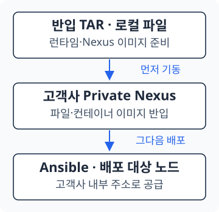

<section class="editorial-summary editorial-summary--text-only" aria-labelledby="editorial-summary-title">
  <div class="editorial-summary-layout">
    <div class="editorial-summary-copy">
      <span class="editorial-summary-label">사내 Gitea 경량화 · 고객사 반입 편</span>
      <h2 id="editorial-summary-title" class="editorial-summary-title">사업수행팀은 TAR 하나를 가져가고, 고객사에서는 그 안의 재료로 배포를 시작한다.</h2>
      <p>사내 Gitea와 Nexus에 접근할 수 없는 환경에서도 준비할 파일을 다시 모으지 않도록 했다. 검증된 TAR에 코드·이미지·런타임·Nexus를 함께 담고, deploy.sh가 Private Nexus와 Ansible 컨테이너를 준비한다.</p>
    </div>
  </div>
  <p class="editorial-summary-result"><span><strong>다운로드 → 반입·압축 해제 → deploy.sh → 고객사 설정 → Ansible 배포</strong>. 컨테이너 기동과 OpenStack 배포 완료는 구분한다.</span></p>
</section>

[5편](../automation/2026-10-21-gitea-lightweight-5.md)까지는 우리 팀과 Runner의 작업이었다. 이번에는 **사업수행팀이 발행된 패키지를 받은 뒤 무엇을 하는지**에 집중한다. 고객사에 Gitea나 Gitea Runner를 다시 구축하는 과정은 필요하지 않다.

## 1. 필요한 릴리스의 TAR 하나 받기

사업수행팀은 사내망에 접근 가능한 서버에서 원하는 채널을 고른다. `current`는 전체 최신 릴리스, `4.1`은 4.1 계열의 최신 패치다.

| 선택 | 다운로드 경로 |
| --- | --- |
| 전체 최신 | `/repository/raw-manifest/channels/current/contrabass-engine-deploy.tar` |
| 4.1 계열 최신 | `/repository/raw-manifest/channels/4.1/contrabass-engine-deploy.tar` |
| 보관 중인 특정 버전 | `/repository/raw-release-bundle/releases/4.1/v4.1.2/contrabass-engine-deploy.tar` |

다음은 빈 다운로드 디렉터리에서 실행하는 예시다. 주소는 사내 다운로드 서버로, `download-user`는 읽기 계정으로 바꾼다. 비밀번호는 프롬프트에 입력한다.

```bash title="사내에서 반입 패키지 다운로드"
set -euo pipefail
CHANNEL=current

tar_url="$(curl -kfL --user download-user \
  "https://192.0.2.10:8443/repository/raw-manifest/channels/${CHANNEL}/contrabass-engine-deploy.tar" \
  -o contrabass-engine-deploy.tar --write-out '%{url_effective}')"

curl -kfL --user download-user "${tar_url}.sha256" \
  -o contrabass-engine-deploy.tar.sha256
sha256sum -c contrabass-engine-deploy.tar.sha256
```

4.1 계열이 필요하면 `CHANNEL=4.1`로 바꾼다. **manifest를 따로 받아 조합할 필요 없이 이 TAR가 반입 파일**이다. HAProxy가 고정 주소를 실제 버전 경로로 안내하므로 `-L`을 사용한다. 리다이렉트 요청과 TAR 본문 다운로드를 두 번 받는 것은 다르다.

`-k`는 자체 서명 인증서를 사용하는 예제의 인증서 검증 생략 옵션이다. 계정 인증을 생략하는 옵션은 아니며, 신뢰할 CA가 준비된 환경에서는 인증서 검증을 유지한다.

받은 TAR는 그 시점의 확정된 파일이다. 다운로드 뒤 `current`가 새 버전으로 바뀌어도 이미 가져온 TAR의 내용이 저절로 바뀌지는 않는다.

**고객사 반입 전에는 같은 버전의 `.tar.sha256`을 함께 받아 TAR 전체를 검증한다.** 위 명령은 `--write-out '%{url_effective}'`로 실제 TAR를 받은 고정 버전 URL을 `tar_url`에 저장한다. 체크섬은 그 URL에 `.sha256`을 붙여 받으므로 도중에 channel이 이동해도 다른 버전의 체크섬을 잘못 받지 않는다.

큰 TAR 본문은 한 번, 작은 체크섬 파일은 한 번 받는다. `curl --user`는 요청마다 비밀번호를 물을 수 있다. 해시가 일치하지 않으면 압축 해제·실행하지 않는다.

---

## 2. 패키지 안에 무엇이 들어 있는가

```text title="contrabass-engine-deploy.tar를 풀었을 때"
contrabass-engine-deploy/
├── deploy.sh                          # 실행 진입점
├── setup-private-environment.sh       # 런타임·Nexus 준비와 파일·이미지 반입
├── manifest.yaml                      # 반입할 재료 목록
├── release-info.yaml                  # 릴리스와 Git 형상 정보
├── git/init-container/                # 해당 릴리스의 Ansible 코드와 설정
├── raw/                               # 일반 파일과 런타임 바이너리
├── images/
│   ├── release-images.tar             # 배포할 컨테이너 이미지 묶음
│   └── image-map.txt                  # 반입 전후 이미지 주소 대응 정보
└── nexus/
    ├── nexus-image.tar                # Nexus 자체 이미지
    ├── compose.yaml
    └── nexus.properties
```

고객사에서 가장 먼저 필요한 것은 Ansible보다 **파일을 공급할 Nexus와 컨테이너 런타임**이다. 그런데 아직 Nexus가 없는 서버에서 런타임을 Nexus URL로 받아오려 하면 순서가 막힌다.

그래서 첫 기동용 containerd·nerdctl·runc·CNI 파일을 TAR의 `raw/`에 함께 넣었다. Nexus 자체 이미지도 로컬 TAR로 불러온다. Nexus가 실행된 다음에 일반 파일과 배포 이미지를 그 Nexus에 넣는다.

[{ .architecture-diagram }](../assets/gitea-lightweight-6/offline-bootstrap.svg)

`release-images.tar`는 여러 컨테이너 이미지를 저장한 묶음이다. Nexus 자체 이미지인 `nexus-image.tar`와 용도가 다르다. `image-map.txt`는 사내 주소의 이미지를 고객사 Nexus 주소로 등록할 때 사용한다.

**manifest·release-info·image-map은 불필요한 설명 파일이 아니다.** 스크립트가 반입 목록·릴리스 정보·이미지 대응 관계를 확인할 때 사용하므로 임의로 지우지 않는다. `git/init-container`는 TAR 내부의 코드 배치 경로이며, 사내 저장소를 다시 clone하라는 뜻은 아니다.

!!! warning "TAR 하나가 OS와 모든 현장 준비를 대신하는 것은 아니다"
    OS 설치·네트워크·접속·디스크 준비는 먼저 끝내야 한다. 이 패키지는 manifest에 담긴 설치 재료를 제공한다. Ansible이 별도 OS 패키지 저장소를 사용한다면 `package_ip`가 가리킬 저장소와 필요한 OS 패키지도 고객사 안에 준비해야 한다. 사내 Nexus의 DB나 Blob Store 전체를 복제해 가져가는 구성은 아니다.

---

## 3. 고객사 배포 노드에서 deploy.sh 실행

<p class="subsection-title"><strong>3-1. 반입과 실행 전 준비</strong></p>

<div class="section-body" markdown="1">

고객사에서 Private Nexus와 Ansible 컨테이너를 실행할 전용 배포 노드를 정한다. 이 구성은 systemd를 사용하는 x86_64 Linux와 root 권한을 전제로 한다.

| 준비할 것 | 확인 내용 |
| --- | --- |
| 배포 노드 주소 | 다른 배포 대상 노드들이 접근할 고정 IP 또는 DNS |
| 디스크 공간 | 원본 TAR·해제 파일·런타임 이미지·Nexus 데이터가 함께 들어갈 공간 |
| 기본 OS 도구 | `bash`, `curl`, `tar`, `sha256sum` 등 실행에 필요한 도구 |
| 기존 서비스 | containerd·Nexus·같은 이름의 컨테이너가 이미 있는지 확인 |
| 네트워크 | 고객사 노드에서 Private Nexus의 HTTPS 포트로 접근 가능 |

전송 방식은 고객사의 반입 절차를 따른다. 시험망에서 SSH 전송이 가능한 경우에는 다음처럼 옮길 수 있다.

```bash title="다운로드 서버에서 고객사 시험 배포 노드로 전송하는 예시"
scp contrabass-engine-deploy.tar root@192.0.2.101:/root/
```

실제 폐쇄망에 직접 SSH로 접근할 수 있다는 전제는 아니다. 반입 매체로 옮기더라도 가져가는 파일은 같다.

</div>

<p class="subsection-title"><strong>3-2. 압축을 풀고 한 번의 진입점으로 시작</strong></p>

<div class="section-body" markdown="1">

기존 배포 디렉터리에 덮어쓰지 않도록 새 작업 위치에서 진행한다. 다음 명령은 고객사 배포 노드에서 실행한다.

```bash title="고객사 배포 노드에서 패키지 실행"
tar -xf contrabass-engine-deploy.tar
cd contrabass-engine-deploy
sudo ./deploy.sh 192.0.2.101 --accept-eula
```

첫 인자는 **Nexus를 띄울 배포 노드의 IP 또는 DNS**다. 여기에 `https://`나 포트를 붙이지 않는다. `--accept-eula`는 Nexus 사용약관을 확인한 뒤 동의를 표시하는 인자다.

| 순서 | 스크립트가 하는 일 |
| --- | --- |
| ① 준비 확인 | 필수 파일·설치 재료 확인. TAR 전체 해시는 압축 해제 전에 검증 |
| ② 런타임 준비 | 로컬 반입 바이너리로 컨테이너 런타임 준비·사용 가능 여부 확인 |
| ③ Nexus 준비 | Nexus 이미지 load, HTTPS 설정, 컨테이너 실행·응답 대기 |
| ④ 재료 반입 | Repository 생성, `raw/` 업로드, 이미지 load·고객사 주소로 tag·push |
| ⑤ Ansible 준비 | 반입한 코드와 이미지를 이용해 `okestro-os-ansible` 실행 |

Nexus의 Repository와 파일 경로는 사내와 같은 형태로 유지한다. 주소만 고객사 것으로 달라지므로 Ansible이 같은 파일 경로를 계속 사용할 수 있다.

일부 단계가 기존 자원을 확인한다고 해서 설치 전체를 무조건 재실행해도 되는 것은 아니다. 실패했다면 원인을 확인한 뒤 필요한 단계를 이어간다. Nexus 데이터를 지우거나 실행 중인 컨테이너를 강제로 삭제하는 것을 기본 복구 절차로 삼지 않는다.

</div>

<p class="subsection-title"><strong>3-3. 두 컨테이너와 실제 Nexus 주소 확인</strong></p>

<div class="section-body" markdown="1">

```bash title="배포 노드에서 상태 확인"
nerdctl ps
nerdctl logs --tail 50 nexus
```

`nexus`와 `okestro-os-ansible`이 실행 중인지 확인한다. Private Nexus 주소는 스크립트의 완료 출력과 `nexus/compose.yaml`의 호스트 포트로 확인한다.

이 시리즈의 고객사 예시는 `https://192.0.2.101:8443`이다. 반입본에서 포트를 바꿨다면 아래 확인 URL과 다음 절의 `nexus_url`을 **그 포트에 맞춰 함께 바꾼다.** 사내 서버의 Nexus 포트와 다운로드 포트도 서로 구분한다.

| 접속점 | 시리즈의 예시 |
| --- | --- |
| 사내 Nexus 직접 접속 | `https://192.0.2.10:55555` |
| 사내 TAR 다운로드 진입점 | `https://192.0.2.10:8443` |
| 고객사 Private Nexus | `https://192.0.2.101:8443` |

```bash title="고객사 Nexus 응답과 반입 파일 확인"
curl -kfsS https://192.0.2.101:8443/service/rest/v1/status
curl -kfsSI \
  https://192.0.2.101:8443/repository/raw-hosted/ansible-runtime/runc.amd64
```

현재 Private Nexus 템플릿은 Raw·Docker의 익명 읽기를 허용하도록 구성되어 있다. 이 설정은 쓰기 권한까지 공개한다는 뜻이 아니다. 사내 Nexus의 다운로드 계정은 고객사 Ansible 변수에 그대로 넣는 값이 아니다.

</div>

---

## 4. 고객사 설정을 맞추고 Ansible 배포 시작

`deploy.sh`가 끝나면 **배포 환경이 준비된 것**이지 OpenStack 전체 설치가 끝난 것은 아니다. 다음은 고객사 서버·네트워크·디스크에 맞는 inventory와 공통 변수를 확인하는 단계다.

반입본의 Ansible 코드는 다음 위치에 있다.

```text title="고객사 설정 파일 위치"
contrabass-engine-deploy/
└── git/init-container/contrabass-engine/okestro/okestro-openstack/
    └── inventory/
        ├── inventory.ini
        └── group_vars/all/
            ├── main.yml
            └── nexus.yml
```

| 파일 | 고객사에서 확인할 것 |
| --- | --- |
| `inventory.ini` | 서버 IP·역할·호스트별 디스크 등 |
| `main.yml` | Nexus 주소·OS 패키지 저장소·네트워크 등 환경별 변수 |
| `nexus.yml` | 반입한 릴리스의 파일 경로와 이미지 태그 유지 |

`main.yml`의 주소는 다음 형식이다. **Ansible 변수에는 `https://` 없이 `IP:PORT`를 적는다.** `deploy.sh`의 인자가 IP만 받는 것과 구분한다.

```yaml title="inventory/group_vars/all/main.yml — 주소 부분"
# Controller01 API Network
nexus_url: 192.0.2.101:8443
package_ip: 198.51.100.10/rocky-9.6
```

`package_ip`는 고객사 내부의 OS 패키지 공급 주소로 바꾼다. `nexus.yml`은 이 Nexus 주소로 Raw URL과 이미지 주소를 구성하며, 환경변수 `NEXUS_URL`을 컨테이너에 별도 전달하는 방식이 아니다. 파일 버전을 바꾸려면 사내에서 manifest와 함께 새 릴리스로 준비하는 것이 기준이다.

컨테이너에 연결된 코드인지 확인한 뒤 접속한다. 다른 경로를 mount한 컨테이너를 사용하면 방금 수정한 파일이 보이지 않을 수 있다.

```bash title="배포 노드에서 Ansible 컨테이너 접속"
nerdctl exec -it okestro-os-ansible sh
```

다음은 **컨테이너 내부**에서 실행한다. 실제 서버 구성을 바꾸는 명령이므로 대상과 변수를 검토한 뒤 진행한다.

```bash title="Ansible 컨테이너 내부에서 배포"
cd /root/okestro/okestro-openstack
ansible-playbook -i inventory/inventory.ini main.yml
```

완료 여부도 세 단계로 나눠 본다.

| 확인 | 의미 |
| --- | --- |
| Nexus·Ansible 컨테이너 기동 | 배포 환경 준비 |
| Ansible 정상 종료 | 지정한 배포 작업 완료 |
| 고객사 기능 확인 | 해당 환경에서 서비스 사용 가능 여부 확인 |

사내 시험을 통과한 릴리스라도 고객사의 네트워크·디스크·자원 조건은 다를 수 있다. 고객사 환경 설정과 현장 확인을 대신하는 것은 아니다.

## 5. 배포 흐름 정리 — Git 경량화가 바꾼 작업

1편의 시작은 26GiB 저장소였다. 끝에서 달라진 것은 파일 크기만이 아니다.

- **개발팀:** 코드와 재료 목록을 관리하고, 태그로 릴리스를 확정한다.
- **Runner:** 필요한 재료를 모아 시험하고, 통과한 동일 TAR를 발행한다.
- **사업수행팀:** 파일을 다시 조합하지 않고, 받은 TAR로 고객사 배포 환경을 준비한다.

개발자가 과거 이미지 이력까지 받던 작업과, 고객사에 설치 재료를 가져가는 작업을 분리했다. 이것이 이 시리즈에서 Git·Nexus·자동화를 함께 정리한 이유다. 다음 7편부터는 이 구조를 계속 사용할 때 필요한 승인·발행 규칙, 저장 공간 관리, 백업·복구로 이어진다.

[← 5편: 배포 시험 후 릴리스](../automation/2026-10-21-gitea-lightweight-5.md) · [7편: 팀의 릴리스 운영 →](../automation/2026-10-22-gitea-lightweight-7.md)
